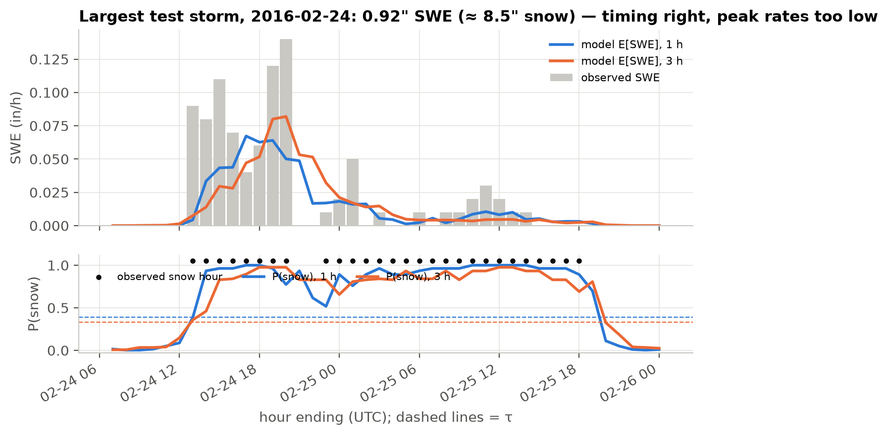
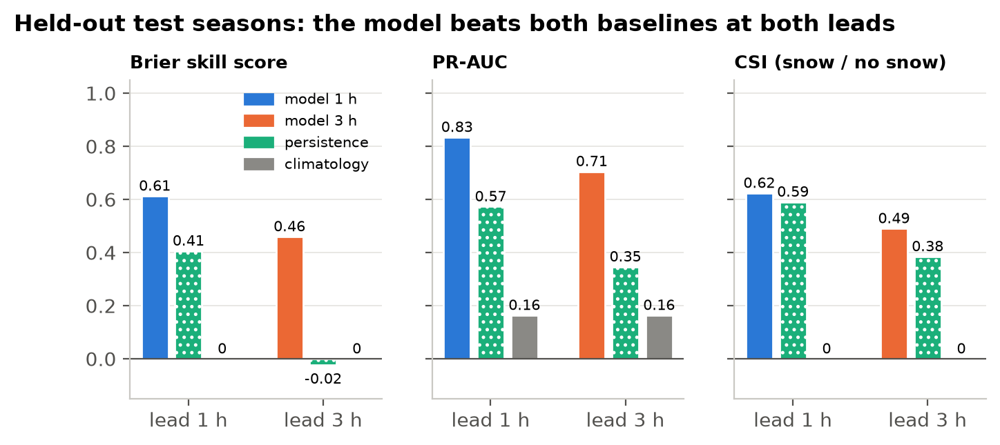
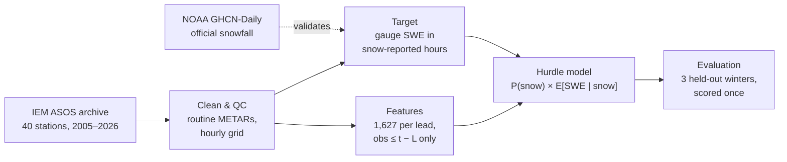
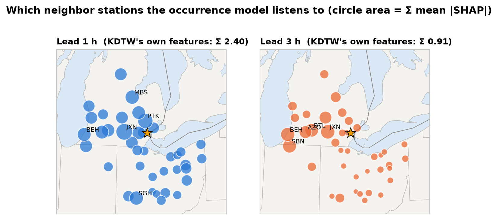

# Hourly snowfall nowcasting at Detroit Metro Airport

[](https://github.com/aaron-bartlett/snowfall-prediction/actions/workflows/ci.yml)


This project predicts **whether it will snow, and how much, in each hour at Detroit Metro Airport
(KDTW), 1 and 3 hours ahead**. The inputs are recent observations from KDTW and 39 surrounding
airport weather stations, and the model is a two-stage LightGBM.



## At a glance

- **It beats both baselines on every headline score at both leads**, on three winters held out
  and scored once.
- **3 hours ahead**, the Brier skill score is **0.46**, against **−0.02** for persistence ("it will
  keep doing what it's doing"). CSI is 0.49 vs 0.38.
- **The probabilities are calibrated.** A forecast of 70% snow verifies about 70% of the time.
- **21 winters of public data** from 40 stations, about 5 million station-hours, built into 1,627
  leakage-tested features.

| lead | system | Brier skill | PR-AUC | CSI | RMSE SWE (in) |
|---|---|---|---|---|---|
| 1 h | **model** | **0.613** | **0.834** | **0.624** | **0.0033** |
| 1 h | persistence | 0.406 | 0.573 | 0.590 | 0.0043 |
| 3 h | **model** | **0.460** | **0.705** | **0.490** | **0.0041** |
| 3 h | persistence | −0.024 | 0.346 | 0.385 | 0.0062 |
| — | climatology | 0 | 0.164 | 0 | 0.0053 |



## How it works



1. **Data.** Hourly METARs for KDTW and every station within 300 km with enough temperature and
   precipitation coverage: 39 of 133 candidates.
2. **Target.** Airports don't report hourly snowfall, so the target is the gauge's liquid
   equivalent during hours with falling snow. It was checked against official daily snowfall.
3. **Features.** Lagged observations plus network summaries: snow coverage by distance ring and
   compass sector, an upstream cone that follows the wind, and a fitted pressure gradient.
4. **Model.** A calibrated LightGBM classifier ("will it snow?") times a Tweedie regressor ("how
   much?"), tuned with season-grouped cross-validation.

## What the model learned



At 1 hour the model leans on Detroit's own cloud ceiling and on snow reports from nearby stations.
At 3 hours its attention moves to stations 100–250 km **west**, which is upwind in typical winter
flow. Those station weights were learned from data, not hand-set. → [Feature engineering](docs/03-features.md)

## Built to be trusted

- **Whole-winter splits.** Seasons were assigned at random to train/validation/test (15/3/3) and
  frozen before any data was examined.
- **Test scored once.** A lock file makes the final evaluation refuse to re-run.
- **Leakage tests.** Index-encoding and future-poisoning tests show no feature can see the target
  hour.
- **Tested.** About 100 unit tests run in CI.
- **Reusable weights.** The trained weights are committed with a load/predict API.

## Limitations

- **Heavy hours are underpredicted.** At ≥ 0.06 in/h the mean forecast is 0.050 at 1 h against
  0.070 observed, so storm totals come out 12% (1 h) and 30% (3 h) low.
- **The target inherits gauge undercatch.** It captures about 82% of official snowfall on test
  days.
- **There are no Ontario stations,** which leaves a gap to the east (mostly downstream).

## Explore

| | |
|---|---|
| [1. Data and stations](docs/01-data.md) | Sources, station selection, METAR cleaning, availability |
| [2. Defining hourly snowfall](docs/02-target.md) | Target construction, GHCN validation, season split |
| [3. Feature engineering](docs/03-features.md) | Time cutoff, spatial aggregates, SHAP, ablation |
| [4. Model and training](docs/04-model.md) | Hurdle model, tuning, calibration, threshold |
| [5. Test results](docs/05-results.md) | Full results, case studies, limitations |
| [6. Reproducing](docs/06-reproduce.md) | Environment, pipeline, figures |

## Quickstart

```bash
conda env create -f environment.yml && conda activate snowfall
python -m pytest            # unit tests, offline, < 1 min
python -m src.viz           # redraw every docs figure from committed artifacts
```

```python
from src.model import HurdleModel
model = HurdleModel.load("models/lead_3h")   # P(snow), expected SWE, deterministic SWE, depth
```

The full pipeline (download → clean → target → features → train → evaluate) is in
[docs/06-reproduce.md](docs/06-reproduce.md).

## Project history

An earlier version of this project used a GRU network on daily GHCN data to predict snow depth
(see the [`archive`](https://github.com/aaron-bartlett/snowfall-prediction/tree/archive) branch).
This version replaces it with an hourly target, a 40-station observation network and a hurdle
model, which together make an operationally meaningful nowcast.

## Data credits

Observations come from the [Iowa Environmental Mesonet](https://mesonet.agron.iastate.edu/) ASOS/AWOS
archive. Daily snowfall comes from [NOAA NCEI GHCN-Daily](https://www.ncei.noaa.gov/products/land-based-station/global-historical-climatology-network-daily).
