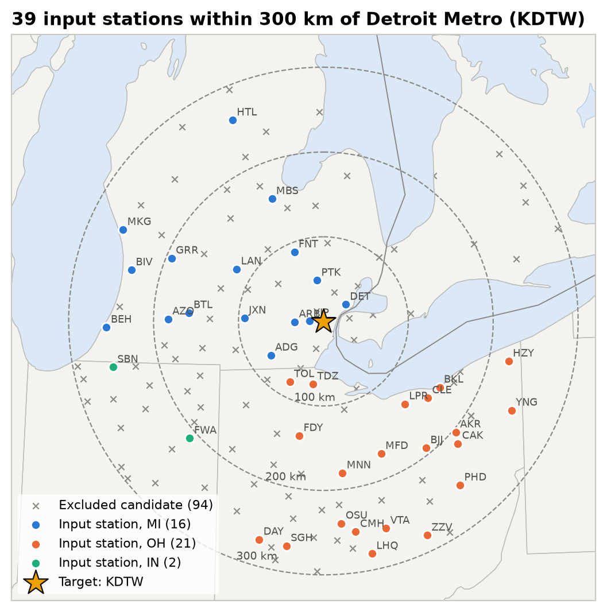
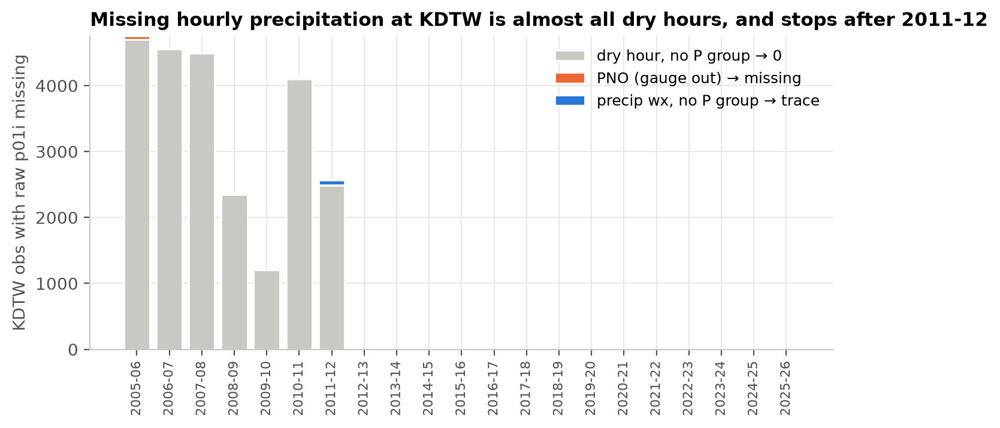
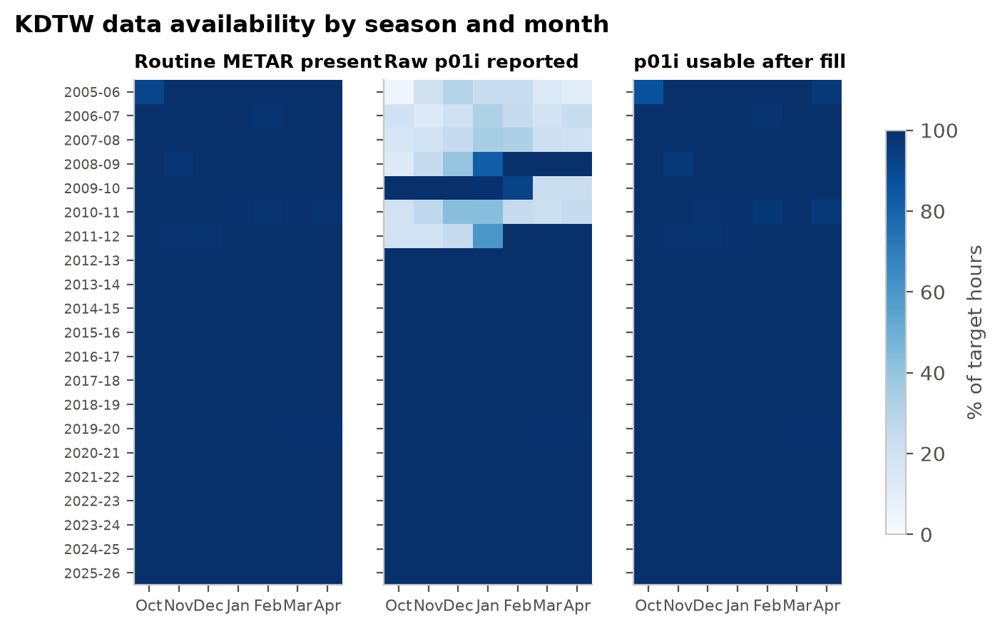
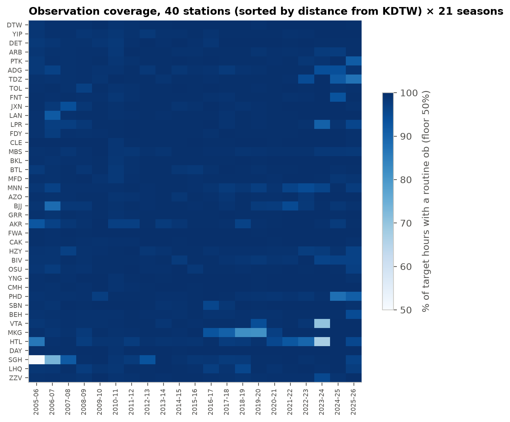

# 1. Data and stations

**TL;DR.** The dataset covers 21 winters (2005-06 to 2025-26, October through April) of hourly airport
observations from Detroit Metro (KDTW) and 39 neighboring stations within 300 km. After cleaning
it holds 4.9 million station-hours. Most of the cleaning effort goes into getting a trustworthy
1-hour precipitation value out of each METAR.

| Key numbers | |
|---|---|
| Seasons | 21 (Oct 1 – Apr 30), 106,968 target hours |
| Stations | KDTW + 39 inputs (OH 21, MI 16, IN 2) out of 133 candidates |
| Raw download | 840 station-season files, 0.94 GB |
| Clean hourly table | 4,883,520 rows (40 stations × 21 season grids) |
| KDTW coverage | routine ob in 99.7% of target hours; usable `p01i` in 99.9% |

## Sources

- **[Iowa Environmental Mesonet ASOS/AWOS archive](https://mesonet.agron.iastate.edu/request/download.phtml).**
  This is METAR observations for every US airport station, downloaded per station and season from
  the IEM CGI endpoint. Only routine hourly reports are kept (`report_type=3`), in UTC.
- **[NOAA GHCN-Daily](https://www.ncei.noaa.gov/products/land-based-station/global-historical-climatology-network-daily)
  `USW00094847`.** This is the official daily snowfall at KDTW. It is used only to validate the
  target ([page 2](02-target.md)) and is never a model input.

## Why KDTW

KDTW is a first-order NWS climate site with a continuous ASOS record and a co-located GHCN-Daily
snowfall series. It gets about 40" of snow a season from synoptic systems (Alberta clippers and
Colorado/Panhandle lows) plus occasional lake-enhanced events, so it has enough snow to learn from
and more than one way for snow to arrive.

## Station selection

Selection started from every ASOS/AWOS station in the IEM Michigan, Ohio, Indiana and Ontario
networks within **300 km** of KDTW, which gave 133 candidates. A station is kept only if, over all
target hours:

- at least **80%** of hours have a routine METAR with a valid temperature, and
- at least **75%** of hours have a raw hourly precipitation value (`p01i`). Both the target and the
  upstream-precipitation features depend on this field.

That leaves **39 input stations**. Of the 94 rejected, 25 fail only the precipitation test and 69
fail the temperature test.

**No Ontario station qualifies.** The best, Goderich, has 73.4% `p01i` coverage, and Windsor and
London are near 71%. That leaves a gap to the east and north-east. In winter that direction is mostly
downstream of Detroit, so the gap matters less than a western gap would.

*Figure 1. Input stations colored by state, the excluded candidates (×), and 100/200/300 km rings.
Notice how dense the coverage is to the west and south-west, which is upstream in typical winter
flow, and the empty band across Lake Erie and Ontario.*

All 39 input stations

| # | IEM ID | Name | State | Dist (km) | Bearing | Temp cov. | Precip cov. |
|---|---|---|---|---|---|---|---|
| 1 | YIP | Detroit/Willow | MI | 16 | 273° W | 99.1% | 79.7% |
| 2 | DET | Detroit/City Air | MI | 33 | 53° NE | 99.1% | 79.6% |
| 3 | ARB | Ann Arbor | MI | 34 | 269° W | 98.7% | 79.3% |
| 4 | PTK | Pontiac | MI | 49 | 351° N | 99.0% | 80.7% |
| 5 | ADG | Adrian | MI | 74 | 237° WSW | 98.2% | 79.0% |
| 6 | TDZ | Toledo | OH | 75 | 189° S | 98.1% | 77.9% |
| 7 | TOL | Toledo | OH | 82 | 209° SSW | 99.4% | 79.7% |
| 8 | FNT | Flint | MI | 89 | 337° NNW | 99.1% | 80.6% |
| 9 | JXN | Jackson/Reynolds | MI | 93 | 272° W | 99.1% | 80.1% |
| 10 | LAN | Lansing | MI | 119 | 301° WNW | 99.2% | 82.1% |
| 11 | LPR | Lorain/Elyria | OH | 137 | 136° SE | 98.4% | 80.1% |
| 12 | FDY | Findlay | OH | 138 | 192° SSW | 99.3% | 75.0% |
| 13 | CLE | Cleveland | OH | 153 | 126° SE | 99.8% | 78.7% |
| 14 | MBS | Saginaw | MI | 157 | 337° NNW | 99.0% | 79.0% |
| 15 | BKL | Cleveland Burke Lakefront | OH | 158 | 120° ESE | 97.5% | 76.9% |
| 16 | BTL | Battle Creek | MI | 158 | 274° W | 99.1% | 80.3% |
| 17 | MFD | Mansfield | OH | 171 | 156° SSE | 99.5% | 80.9% |
| 18 | MNN | Marion | OH | 181 | 173° S | 98.2% | 78.5% |
| 19 | AZO | Kalamazoo | MI | 183 | 271° W | 99.2% | 81.7% |
| 20 | BJJ | Wooster | OH | 193 | 141° SE | 98.1% | 76.0% |
| 21 | GRR | Grand Rapids | MI | 194 | 293° WNW | 99.7% | 81.6% |
| 22 | AKR | Akron | OH | 204 | 130° SE | 98.2% | 76.2% |
| 23 | FWA | Fort Wayne | IN | 210 | 229° SW | 99.9% | 76.8% |
| 24 | CAK | Akron / Canton | OH | 214 | 132° SE | 99.7% | 78.6% |
| 25 | HZY | Ashtabula | OH | 223 | 102° ESE | 98.7% | 76.7% |
| 26 | BIV | Holland | MI | 234 | 285° WNW | 98.7% | 85.2% |
| 27 | OSU | Columbus/St Univ | OH | 240 | 175° S | 99.2% | 79.3% |
| 28 | YNG | Youngstown | OH | 246 | 115° ESE | 99.8% | 82.9% |
| 29 | CMH | Columbus | OH | 252 | 171° S | 99.8% | 76.9% |
| 30 | PHD | New Philadelphia | OH | 252 | 140° SE | 98.2% | 78.7% |
| 31 | SBN | South Bend | IN | 254 | 258° WSW | 99.4% | 76.4% |
| 32 | BEH | Benton Harbor | MI | 256 | 268° W | 98.6% | 85.1% |
| 33 | VTA | Newark | OH | 256 | 163° SSE | 96.6% | 77.5% |
| 34 | MKG | Muskegon | MI | 260 | 295° WNW | 96.9% | 84.0% |
| 35 | HTL | Houghton Lake | MI | 260 | 336° NNW | 95.5% | 83.3% |
| 36 | DAY | Dayton | OH | 269 | 196° SSW | 99.8% | 75.7% |
| 37 | SGH | Springfield | OH | 269 | 189° S | 92.4% | 78.2% |
| 38 | LHQ | Lancaster | OH | 281 | 168° SSE | 98.7% | 78.7% |
| 39 | ZZV | Zanesville | OH | 281 | 154° SSE | 99.1% | 79.2% |

Full candidate list with coverage: [`meta/station_candidates.csv`](../meta/station_candidates.csv).

## Cleaning METARs into an hourly grid

- **One routine ob per hour.** Routine METARs are issued at about :51–:56 and are assigned to the
  hour they end. Intra-hour reports at :11–:39 are dropped, so `p01i` is always a true 1-hour total.
  Station selection and cleaning share the same rule ([`src/timeutil.py`](../src/timeutil.py)).
- **Recovering untagged routine reports.** KDTW 2006-07 first came back with only 2,925 rows:
  the archive returns no `report_type=3` obs for Jan–Apr 2007, even though the observations exist
  untagged. The downloader re-fetches any short station-season without the filter and keeps only
  obs at that station's routine minute. That brought KDTW 2006-07 to 5,787 rows. The few seasons
  still short (VTA and HTL 2023-24, SGH 2005-07) are genuine archive gaps.
- **Present weather.** `wxcodes` is parsed into flags: falling snow (with intensity −/none/+), rain,
  freezing rain, ice pellets, fog/mist, blowing snow, thunder and mixed precipitation. Vicinity
  (`VC`) codes are ignored.
- **Wind and sky.** Wind direction and speed become u/v components. Sky cover becomes an ordinal
  0–4. Ceiling is the lowest BKN/OVC/VV layer, or 20,000 ft when there is no ceiling.

## The `p01i` problem

19.8% of KDTW's raw hourly precipitation values are missing. Before treating them as gaps, each one
was classified using the full METAR text:

| Category | Rule | KDTW obs |
|---|---|---|
| (a) `PNO` in remarks | gauge not operating → left missing | 137 |
| (b) `Prrrr` group present | parsed from the METAR | 0 |
| (c) precip in `wxcodes`, no P group | → trace | 89 |
| (d) no precip, no P group | dry hour → 0.0 | 23,872 |
| (e) no METAR | left missing | 0 |

*Figure 2. Almost every missing value is a dry hour, where the P group is simply omitted. From
2012-13 on, the archive has no missing values at all, which looks like a change in how IEM fills
dry hours.*

## QC

- **Range checks:** for example, temperature between −40 and 110 °F and `p01i` between 0 and 3 in.
- **Spike checks:** a value is nulled only when it differs from *both* the hour before and the hour
  after by more than 15 °F/h (temperature) or 8 hPa/h (pressure). The simpler one-sided rule was
  rejected because it nulled valid values next to gaps and removed real frontal temperature drops.

The highest nulling rate for any variable at any station is 0.25%. For KDTW it is 0
([`reports/qc_summary.csv`](../reports/qc_summary.csv)).

## Availability

*Figure 3. KDTW by season and month. Routine observations are essentially complete. Raw `p01i`
has large holes before 2012-13 (Figure 2), and after filling, usable precipitation is above 99%
everywhere.*

*Figure 4. All 40 stations sorted by distance. Coverage is high almost everywhere. The pale cells
are the archive gaps listed above. LightGBM handles the remaining missing values natively.*

---
**Code:** [`src/stations.py`](../src/stations.py) · [`src/download.py`](../src/download.py) · [`src/clean.py`](../src/clean.py)
**Generated reports:** [`reports/p01i_missing_diagnostic.md`](../reports/p01i_missing_diagnostic.md) · [`reports/qc_summary.csv`](../reports/qc_summary.csv)

[← Docs index](README.md) · [Next: the target →](02-target.md)
