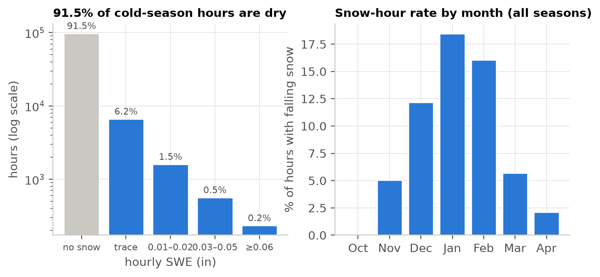
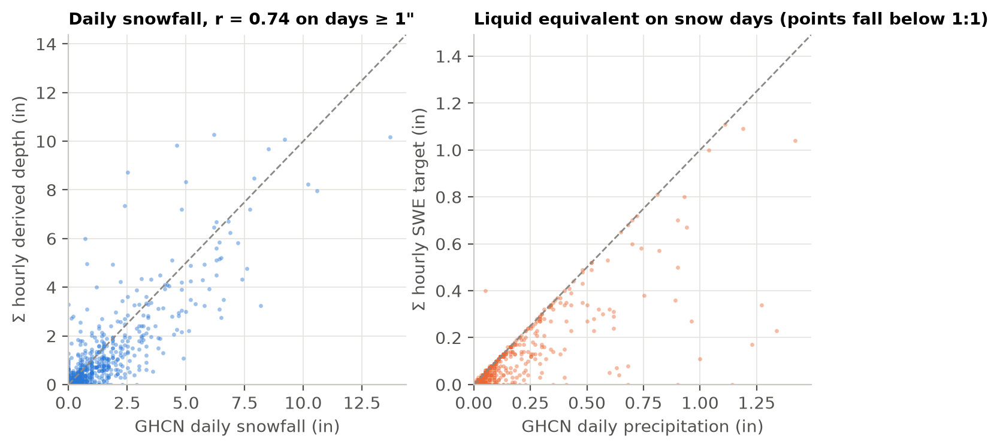
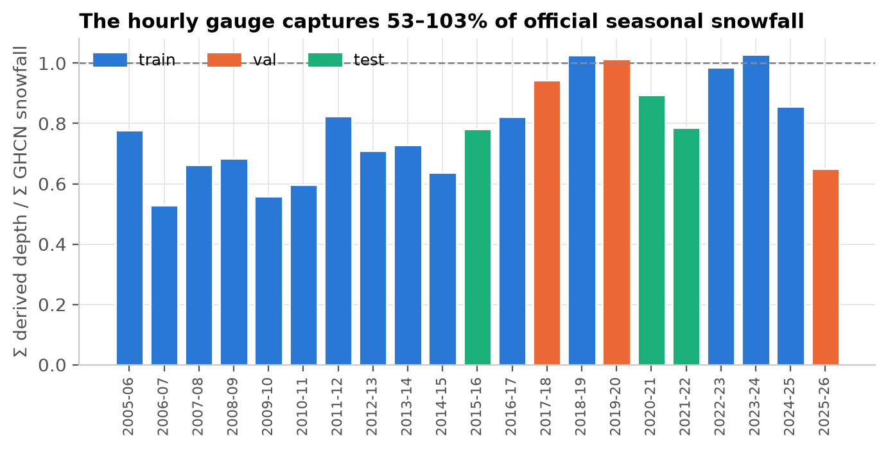
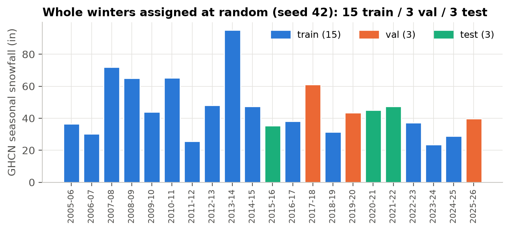

# 2. Defining hourly snowfall

**TL;DR.** Airport stations don't report hourly snowfall. The target is therefore built as *the
gauge's liquid equivalent during hours when falling snow is reported*, and then checked against
the official daily snowfall record. The check shows the gauge undercatches snow, and the model is
trained on the observed quantity anyway.

| Key numbers | |
|---|---|
| Target hours available | 106,536 of 106,968 (99.6%) |
| Hours with falling snow | 8.47% (train 8.28%, val 9.47%, test 8.38%) |
| Measurable snow hours (≥ 0.01" SWE) | 2.25% |
| Snow hours with mixed precip | 3.4% |
| Derived depth / GHCN snowfall per season | mean 0.79 (range 0.53–1.03) |

## Definition

$$
y_\mathrm{swe}(t) = \begin{cases} p01i(t) & \text{if the hour-}t\text{ METAR reports falling snow (SN, SG, SHSN, …)}\\ 0 & \text{otherwise}\end{cases}
$$

- Blowing snow alone (`BLSN`) doesn't count. That's snow already on the ground being moved by wind.
- A **trace** of precipitation counts as *snow occurred* for the classifier, with amount 0 for the
  regressor.
- Mixed precipitation (for example `RASN`) is kept and flagged.
- **Derived depth** $= y_\mathrm{swe} \times \mathrm{SLR}(T)$, using a temperature-dependent
  snow-to-liquid ratio:

  | T (°F) | < 15 | 15–25 | 25–31 | 31–34 | ≥ 34 |
  |---|---|---|---|---|---|
  | ratio | 18:1 | 15:1 | 12:1 | 10:1 | 8:1 |

  Depth is a reported product. The model is not trained on it.

## Snow is rare, which is why the model has two stages

*Figure 5. Over 91% of cold-season hours have no snow, and most snow hours are only a trace. A
single regression model would mostly learn to predict zero. This motivates the two-stage hurdle
model on [page 4](04-model.md).*

## Checking the target against the official record

Summing the hourly target over each local-standard-time day and comparing it with GHCN-Daily
snowfall:

*Figure 6. Day by day, the hourly target tracks official snowfall (r = 0.74 on days with 1" or more)
but sits below the 1:1 line. The liquid-equivalent panel shows the cause: the heated tipping-bucket
gauge catches less than the manual measurement, especially in cold, windy snow.*

*Figure 7. Seasonal capture ranges from 53% to 103%. It is worst in the early seasons (0.53–0.82
up to 2016-17) and mostly 0.86–1.03 since 2017-18.*

- **2006-07, the worst season (ratio 0.53), was investigated.** It is also the season that needed
  the routine-report recovery. The raw METARs do carry precipitation groups on every snow ob, but
  the gauge mostly reported `P0000` (trace) in cold, windy snow, for example 12 °F with 24 kt gusts
  on 2007-02-13. The untouched December 2006 data shows the same pattern. So this is real gauge
  undercatch, not an artifact of the download fix.
- **A correction factor of 1.365** (Σ GHCN / Σ derived depth over the train seasons) was computed
  but **not applied**. The model predicts what the gauge measures, and the gap to GHCN is reported
  separately on [page 5](05-results.md).

## Train / validation / test split

*Figure 8. Whole winters are assigned at random, 15 train / 3 validation / 3 test.*

- **Why whole seasons.** Snow hours are strongly autocorrelated, and a random hour-level split
  would leak storms across the split. Each season is separated from the next by a summer.
- **Frozen first.** The assignment (`numpy` seed 42) was generated once, before any data was
  examined, and saved to [`meta/splits.json`](../meta/splits.json). It has never been regenerated.
- **What the random split does here.** It spreads the early-season undercatch across all three sets
  rather than concentrating it in one.

| Split | Seasons |
|---|---|
| Train (15) | 2005-06 … 2014-15, 2016-17, 2018-19, 2022-23, 2023-24, 2024-25 |
| Validation (3) | 2017-18, 2019-20, 2025-26 |
| Test (3) | 2015-16, 2020-21, 2021-22 |

---
**Code:** [`src/target.py`](../src/target.py) · [`src/splits.py`](../src/splits.py)
**Generated reports:** [`reports/target_validation.md`](../reports/target_validation.md) (per-season table, ten largest snow days)

[← Data](01-data.md) · [Next: feature engineering →](03-features.md)
