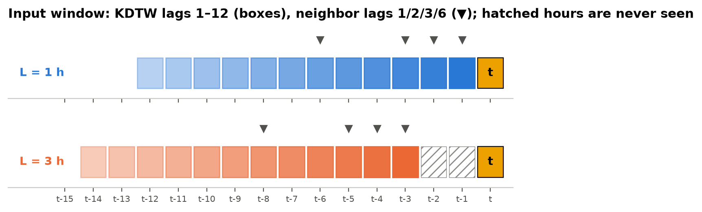
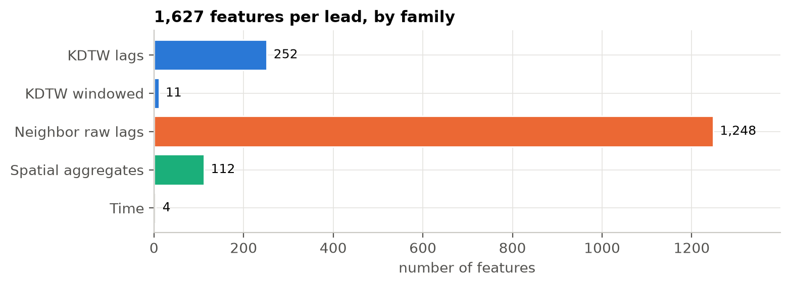
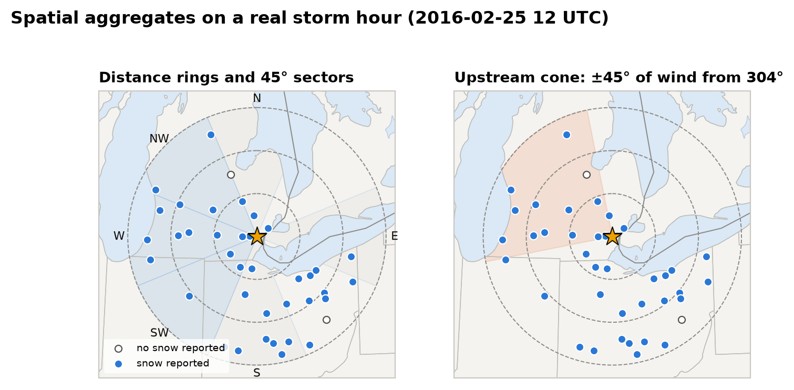
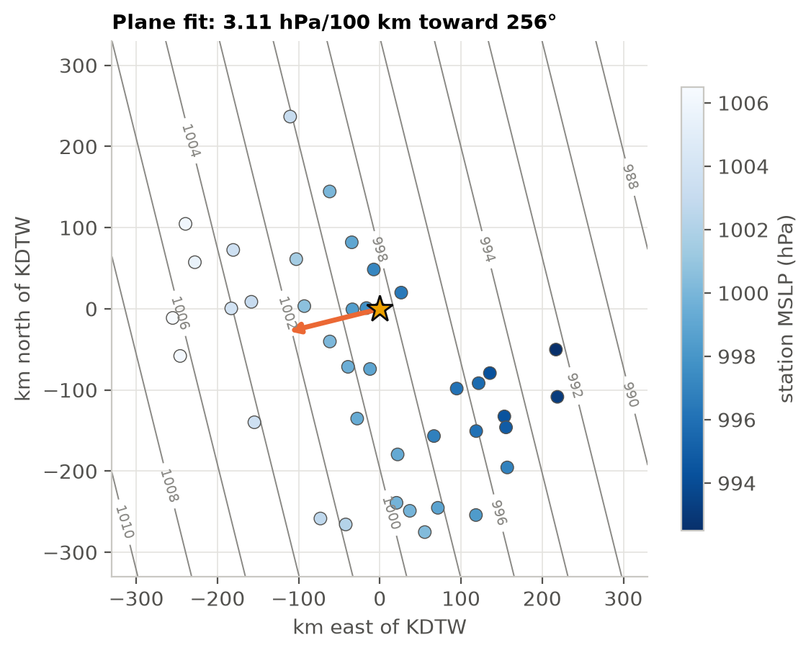
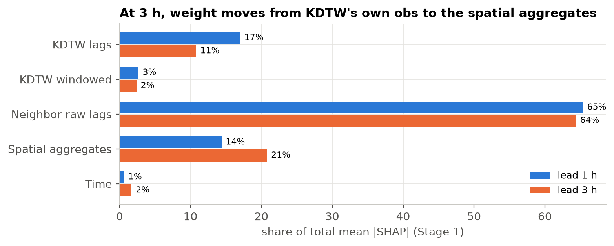
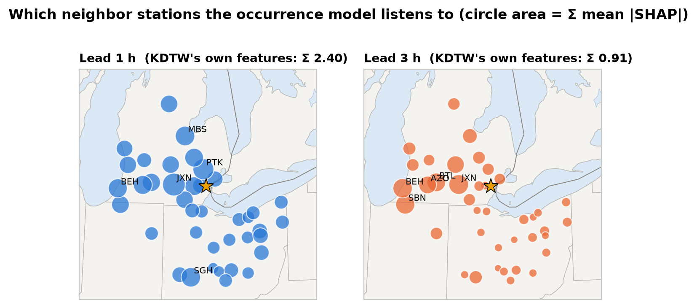
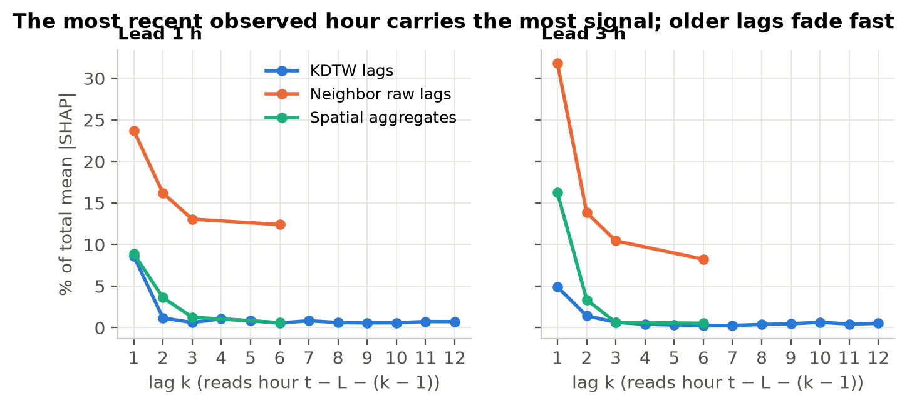
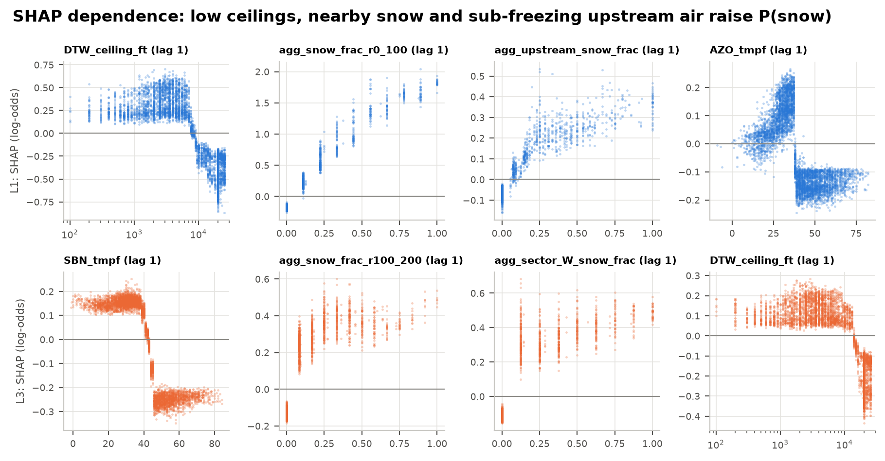
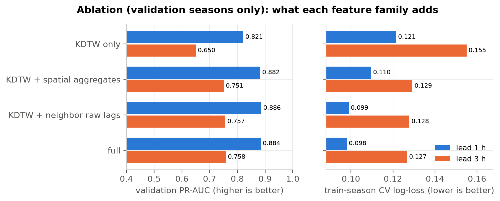

# 3. Feature engineering

**TL;DR.** Each forecast gets 1,627 features from KDTW and the 39 neighboring stations, built under
a strict rule: nothing from the target hour or later. Besides raw lagged observations, 28
hand-built *spatial aggregates* summarize the whole network: snow coverage by distance ring and
compass sector, an upstream cone that follows the wind, and a fitted pressure gradient. SHAP shows
the model relying on physically sensible signals. As lead time grows, its attention moves outward
and upwind.

| Key numbers | lead 1 h | lead 3 h |
|---|---|---|
| Features | 1,627 | 1,627 |
| Share of SHAP from KDTW's own observations | 20% | 13% |
| Share of SHAP from spatial aggregates | 14% | 21% |
| Top neighbor stations | Jackson, Pontiac, Saginaw | Jackson, Benton Harbor, South Bend |

## 1. What the model is allowed to see

A feature for target hour *t* at lead *L* uses **only hours ≤ t − L**:

- **Lag k** reads hour *t − L − (k − 1)*. "Lag 1" is the most recent hour the model may see.
- **Windowed features** (sums, tendencies, streaks) are computed on the unshifted series and read
  at *t − L*, so every window ends at *t − L*.
- The same code builds both leads. Only *L* changes.

*Figure 9. At L = 3 the two hours before the target are invisible (hatched), and the whole window
slides back.*

**Enforced by tests, not by convention** ([`tests/unit/test_phase5.py`](../tests/unit/test_phase5.py)):

- **Index-encoding.** A synthetic dataset where every value encodes its own station and hour. Each
  feature must decode to exactly the hour its name promises.
- **Future-poisoning.** Every observation after *t − L* is overwritten with garbage and the feature
  rows must not change. This runs on synthetic data and on a real January 2014 slice, at both
  leads.

## 2. Inventory

*Figure 10. 1,627 features per lead.*

| Family | Count | Contents |
|---|---|---|
| KDTW lags | 252 | 21 variables × lags 1–12: temperature, dewpoint, RH, dewpoint depression, u/v wind, speed, gust, MSLP, altimeter, visibility, ceiling, sky cover, `p01i`, and flags for snow, rain, freezing rain, ice pellets, fog/mist and blowing snow, plus snow intensity |
| KDTW windowed | 11 | MSLP and temperature tendencies over 1/3/6 h; snow-water sums over 3/6/12 h; hours since last snow (capped at 72); current snow streak |
| Neighbor raw lags | 1,248 | 39 stations × 8 variables (T, Td, u, v, MSLP, `p01i`, snow flag, visibility) × lags 1, 2, 3, 6 |
| Spatial aggregates | 112 | 28 per-hour network summaries × lags 1, 2, 3, 6 |
| Time | 4 | hour of day and day of year as sin/cos pairs |

**Missing values are left as NaN.** LightGBM learns a default split direction for missing values,
and a *number of stations reporting* feature tells the model how much information it has. Nothing
is imputed.

## 3. Spatial aggregates

Raw neighbor lags are wide, station-specific and break when a station is offline. The aggregates
condense the network into a few robust, physically motivated numbers. Each is computed from
same-hour values only, then lagged like any other variable.

*Figure 11. 2016-02-25 12 UTC, during the largest test storm. Nearly every station reports snow.
Left: distance rings and the six compass sectors. Right: the upstream cone follows the
network-mean wind, here from 304° (north-west).*

| Aggregate | Definition | Why |
|---|---|---|
| **Ring snow count / fraction** | stations reporting snow within 0–100, 100–200, 200–300 km | how close the snow shield is |
| **Sector snow fraction, precip sum** | 45° octants W, SW, NW, N, S, E (N and E hold one station each) | where the snow is coming from |
| **Upstream snow fraction, IDW precip** | stations within ±45° of the network vector-mean wind, inverse-distance weighted; NaN when the mean wind is under 1 kt | what is being advected toward KDTW right now |
| **IDW means** | inverse-distance-squared means of T, Td, MSLP, `p01i` | a smoothed regional state |
| **MSLP gradient** | least-squares plane fit of station pressure (≥ 8 stations): magnitude in hPa/100 km and direction | the synoptic setting |
| **Temperature spread** | max − min station temperature | frontal zones and rain/snow lines |
| **Stations reporting** | count of stations with an ob | data availability |

*Figure 12. The same hour. Station pressures (dots), the fitted plane (contours) and its gradient
(arrow, pointing toward higher pressure). Two numbers replace 39 pressure readings.*

## 4. What the model actually uses

SHAP values for the Stage 1 (occurrence) model were computed on 5,000 random test hours.

*Figure 13. Neighbor raw lags carry about two-thirds of the attribution at both leads. Between 1 h
and 3 h, weight moves from KDTW's own observations (17% → 11%) to the spatial aggregates
(14% → 21%). Persistence-like local signals fade and network-wide summaries take over.*

*Figure 14. Summed importance of each station's raw features. At 1 h it is spread over near
neighbors in every direction. At 3 h it concentrates on the **western** stations (Jackson, Benton
Harbor, South Bend, Battle Creek, Kalamazoo, Lansing), roughly 100–250 km upwind. At typical winter
system speeds that is a 2–5 hour head start.*

*Figure 15. The most recent visible hour (lag 1) carries 41% (1 h) and 53% (3 h) of all
attribution. The share drops quickly with each older lag.*

*Figure 16. The learned relationships are physically sensible:*
- *a ceiling below about 8,000 ft raises P(snow)*
- *the fraction of nearby stations reporting snow pushes it up almost linearly*
- *the first upstream stations to report snow matter most*
- *an upstream temperature below roughly 38–45 °F (Kalamazoo at 1 h, South Bend at 3 h) flips the
  contribution from negative to positive, which is the rain/snow line*

Top 20 Stage 1 features by mean |SHAP|

| rank | lead 1 h | lead 3 h |
|---|---|---|
| 1 | `DTW_ceiling_ft_lag1` 0.330 | `SBN_tmpf_lag1` 0.173 |
| 2 | `agg_snow_frac_r0_100_lag1` 0.279 | `agg_snow_frac_r100_200_lag1` 0.170 |
| 3 | `agg_snow_count_r0_100_lag1` 0.258 | `AZO_tmpf_lag1` 0.161 |
| 4 | `DTW_sky_cover_lag1` 0.228 | `DTW_ceiling_ft_lag1` 0.149 |
| 5 | `DTW_hours_since_snow` 0.174 | `agg_sector_W_snow_frac_lag1` 0.147 |
| 6 | `DTW_snow_intensity_lag1` 0.151 | `agg_snow_count_r100_200_lag1` 0.142 |
| 7 | `DTW_wx_snow_lag1` 0.140 | `JXN_tmpf_lag1` 0.122 |
| 8 | `agg_snow_count_r100_200_lag2` 0.131 | `agg_snow_frac_r0_100_lag1` 0.122 |
| 9 | `AZO_tmpf_lag1` 0.120 | `agg_snow_count_r0_100_lag1` 0.113 |
| 10 | `MBS_dwpf_lag1` 0.099 | `BTL_tmpf_lag1` 0.104 |
| 11 | `agg_snow_frac_r100_200_lag1` 0.087 | `agg_sector_NW_snow_frac_lag1` 0.094 |
| 12 | `agg_snow_count_r100_200_lag1` 0.079 | `DTW_sky_cover_lag1` 0.084 |
| 13 | `PTK_tmpf_lag1` 0.078 | `agg_upstream_snow_frac_lag1` 0.078 |
| 14 | `agg_sector_W_snow_frac_lag1` 0.077 | `agg_snow_frac_r200_300_lag1` 0.075 |
| 15 | `ARB_vsby_lag1` 0.076 | `agg_snow_count_r200_300_lag1` 0.075 |
| 16 | `agg_upstream_snow_frac_lag1` 0.075 | `JXN_dwpf_lag1` 0.074 |
| 17 | `BTL_tmpf_lag1` 0.073 | `LAN_dwpf_lag1` 0.073 |
| 18 | `JXN_tmpf_lag1` 0.072 | `hod_sin` 0.070 |
| 19 | `DTW_dwpf_lag1` 0.062 | `BEH_tmpf_lag1` 0.067 |
| 20 | `ARB_wx_snow_lag1` 0.060 | `agg_snow_count_r100_200_lag2` 0.046 |

## 5. Does it pay off? A validation-only ablation

SHAP shows what the full model uses, not what would be lost without it. To measure that directly,
the Stage 1 classifier was refit on nested feature sets.

*Figure 17. Validation PR-AUC and train-season CV log-loss for each feature set.*

| feature set | # features | CV log-loss 1 h | val PR-AUC 1 h | CV log-loss 3 h | val PR-AUC 3 h |
|---|---|---|---|---|---|
| A: KDTW only | 267 | 0.1215 | 0.821 | 0.1550 | 0.650 |
| C: A + spatial aggregates | 379 | 0.1096 | 0.882 | 0.1293 | 0.751 |
| B: A + neighbor raw lags | 1,515 | 0.0990 | 0.886 | 0.1278 | 0.757 |
| D: full (shipped) | 1,627 | **0.0980** | 0.884 | **0.1267** | **0.758** |
| *persistence (reference)* | — | — | 0.633 | — | 0.413 |

**What this shows.**
- **The neighbor network is where the skill comes from, especially at 3 h.** Going from KDTW
  alone to the full set lifts 3 h validation PR-AUC from 0.65 to 0.76 and cuts CV log-loss by 18%.
  At 1 h the gain is smaller (0.82 → 0.88), because Detroit's own last observation already says a
  lot about the next hour.
- **112 aggregates do almost the work of 1,248 raw features.** Adding only the spatial aggregates
  (set C, 379 features) recovers most of the gain from the raw neighbor lags (set B). At 3 h the
  two are within 0.006 PR-AUC.
- **The full set is best on CV log-loss at both leads.** On the 3 validation winters, B, C and D
  are within noise of each other at 1 h.
- **The harness is checked.** Set D reproduces the shipped model's CV log-loss and tree count
  exactly (0.0980 / 539 trees at 1 h, 0.1267 / 272 at 3 h).

**Protocol.**
- Stage 1 hyperparameters are frozen at the shipped model's values.
- Each set gets 5-fold season-grouped CV on the training winters, then a refit, then scoring on the
  3 validation winters.
- Test seasons were not loaded ([`src/ablation.py`](../src/ablation.py)).

**Caveats.**
- The hyperparameters were tuned for the full set, which slightly favors it.
- Three validation winters make differences of a few thousandths noise.
- Only occurrence (Stage 1) is ablated.

---
**Code:** [`src/features.py`](../src/features.py) · [`src/ablation.py`](../src/ablation.py) · [`src/viz/summaries.py`](../src/viz/summaries.py)
**Generated reports:** [`reports/ablation_val.md`](../reports/ablation_val.md) · [`reports/summaries/`](../reports/summaries/)

[← Target](02-target.md) · [Next: model →](04-model.md)
