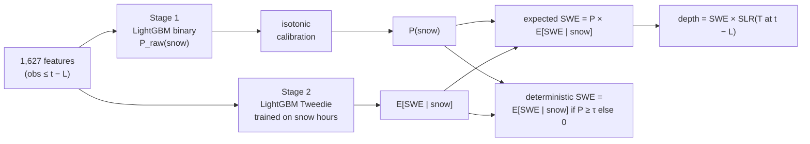
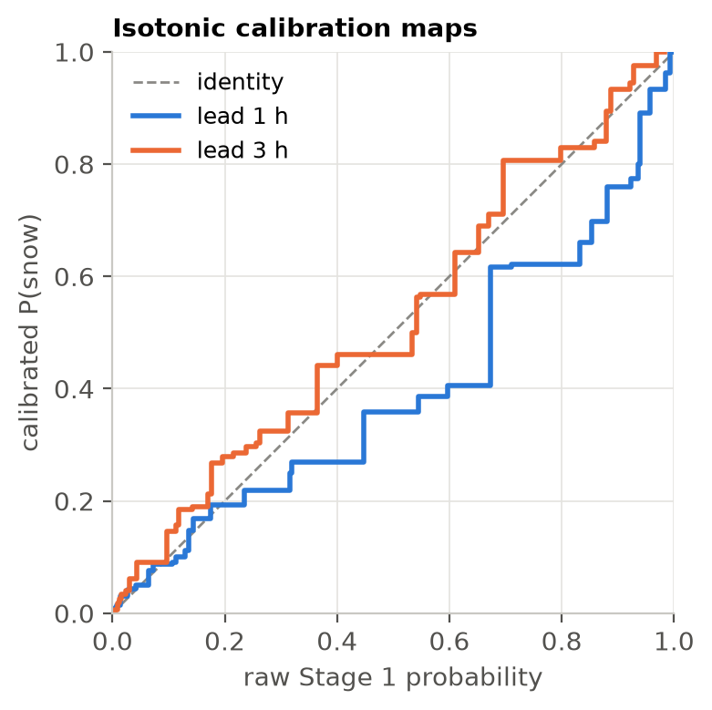
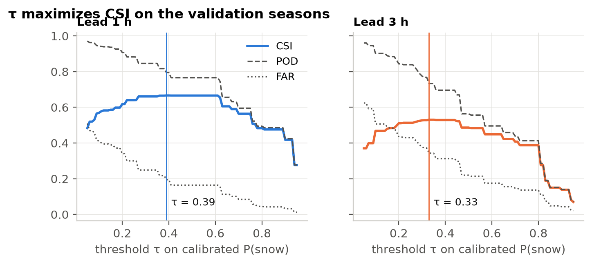

# 4. Two-stage hurdle model and training

**TL;DR.** The model is two LightGBM models per lead. A calibrated classifier answers *"will it
snow this hour?"* and a Tweedie regressor answers *"how much, if it does?"*. Multiplying the two
gives the expected snowfall. Hyperparameters are tuned with season-grouped cross-validation on the
training winters. The validation winters are used only for calibration and the decision threshold.



## Why two stages

91.5% of hours are dry ([page 2](02-target.md)), and among snow hours the amounts are heavily
skewed. A *hurdle* model separates the two questions:

- **Stage 1** (binary log-loss) predicts occurrence, with the label "snow reported, trace or more".
  Class imbalance is handled with a tuned `scale_pos_weight`.
- **Stage 2** predicts the amount and is trained only on snow hours, with trace hours given amount
  0. This keeps $P(\mathrm{snow}) \times E[\mathrm{SWE}\mid\mathrm{snow}]$ consistent with the
  Stage 1 label. Two objectives were tuned: Tweedie (variance power searched over 1.1–1.9) and L2
  on `log1p(SWE)`. **Tweedie won on validation MAE at both leads** (1 h: 0.00454 vs 0.00478 in;
  3 h: 0.00636 vs 0.00667 in).

## Tuning

Tuning used Optuna (TPE sampler with a median pruner) and **5-fold `GroupKFold` by season**
within the 15 training winters, so a validation fold never shares a winter with its training folds.
Each fold uses early stopping (100 rounds, at most 5,000 trees). The final model is refit on all
training winters with the median best iteration count.

| Parameter | Search range |
|---|---|
| `num_leaves` | 15–255 |
| `max_depth` | 4–12 or unlimited |
| `learning_rate` | 0.01–0.1 (log) |
| `min_child_samples` | 20–500 |
| `feature_fraction` | 0.2–0.9 |
| `bagging_fraction` | 0.5–1.0 |
| `lambda_l1`, `lambda_l2` | 0.001–10 (log) |
| `scale_pos_weight` (Stage 1) | 1–20 |
| `tweedie_variance_power` (Stage 2) | 1.1–1.9 |

**Best Stage 1 parameters:**

| | lead 1 h | lead 3 h |
|---|---|---|
| CV log-loss | 0.0980 | 0.1267 |
| trees | 539 | 272 |
| `num_leaves` / `max_depth` | 85 / 7 | 43 / 8 |
| `learning_rate` | 0.041 | 0.040 |
| `min_child_samples` | 87 | 100 |
| `feature_fraction` / `bagging_fraction` | 0.40 / 0.68 | 0.23 / 0.78 |
| `lambda_l1` / `lambda_l2` | 0.067 / 1.38 | 0.29 / 1.74 |
| `scale_pos_weight` | 4.79 | 1.05 |

Stage 2 (Tweedie) used variance power 1.23 at 1 h and 1.25 at 3 h, with 792 and 413 trees.

> [!NOTE]
> The tuning budget was time-limited. Stage 1 hit its 60-minute Optuna timeout after 13 (1 h) and
> 16 (3 h) of the 40 planned trials. The limits were left as configured rather than extended after
> seeing results. Full parameters are in [`models/lead_1h/metadata.json`](../models/lead_1h/metadata.json).

## Calibration

The raw Stage 1 probabilities are pushed around by `scale_pos_weight`. An isotonic regression fit
on the **validation** winters maps them back to observed frequencies:


*Figure 15. The 1 h model (`scale_pos_weight` 4.8) is over-confident above about 0.4 and gets
pulled down. The 3 h model (1.05) needs much less correction.*

## Decision threshold τ

For yes/no forecasts and the deterministic amount, the threshold τ on calibrated P(snow) is set to
maximize CSI on the validation winters:


*Figure 16. The CSI curve is flat near its peak. τ = 0.39 (1 h) and 0.33 (3 h).*

## Validation metrics

> [!IMPORTANT]
> The calibrator and τ were fit on these same validation seasons, so these numbers are
> **optimistic**. The honest numbers are the held-out test results on [page 5](05-results.md).

| lead | system | Brier | BSS vs clim | ROC-AUC | PR-AUC | CSI |
|---|---|---|---|---|---|---|
| 1 h | model | 0.0270 | 0.666 | 0.984 | 0.878 | 0.666 |
| 1 h | persistence | 0.0411 | 0.492 | 0.879 | 0.633 | 0.643 |
| 3 h | model | 0.0402 | 0.503 | 0.965 | 0.751 | 0.530 |
| 3 h | persistence | 0.0731 | 0.098 | 0.786 | 0.413 | 0.442 |

## Using the trained models

Each `models/lead_{1,3}h/` folder contains `stage1_classifier.txt` and `stage2_regressor.txt`
(LightGBM native model files), `calibrator.json` (isotonic thresholds) and `metadata.json`
(the ordered feature list, parameters, τ, seasons and library versions).

```python
from src.model import HurdleModel

model = HurdleModel.load("models/lead_1h")
out = model.predict(features_df)      # selects features by name; raises if any is missing
out[["p_cal", "swe_expected", "swe_det", "depth"]]
```

```bash
python -m src.predict --lead 1 --time 2018-01-12T15:00Z   # needs data/processed/features_L1.parquet
```

---
**Code:** [`src/train.py`](../src/train.py) · [`src/model.py`](../src/model.py) · [`src/metrics.py`](../src/metrics.py) · [`src/predict.py`](../src/predict.py)
**Generated reports:** [`reports/val_metrics.md`](../reports/val_metrics.md)

[← Feature engineering](03-features.md) · [Next: results →](05-results.md)
