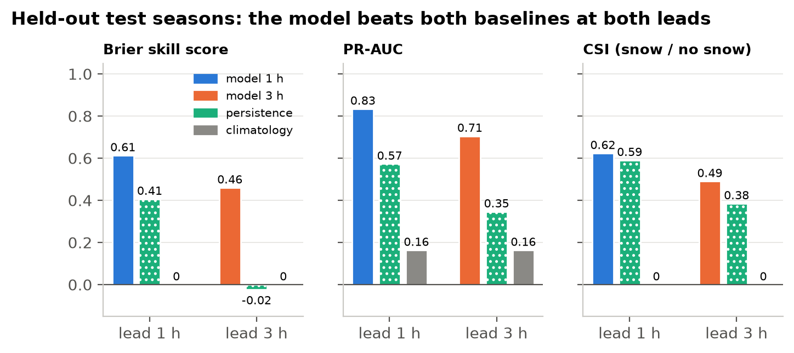
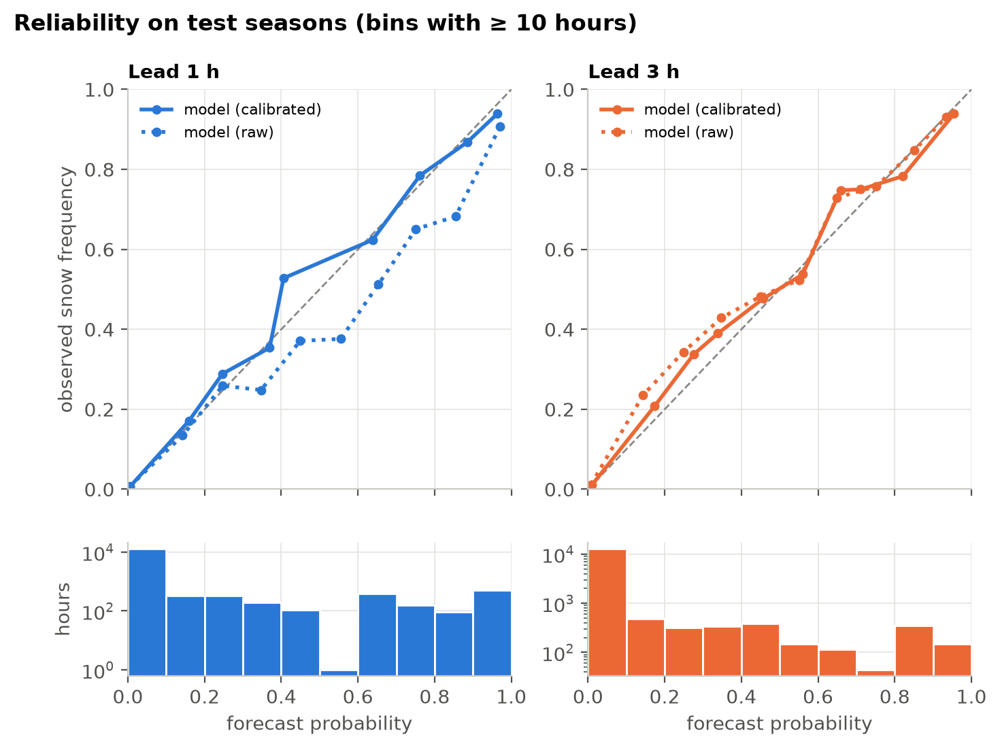
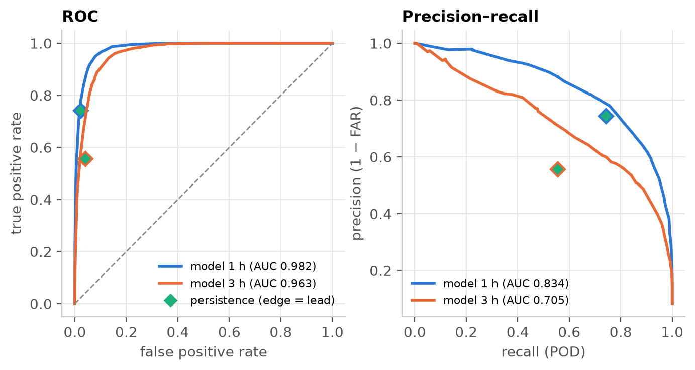
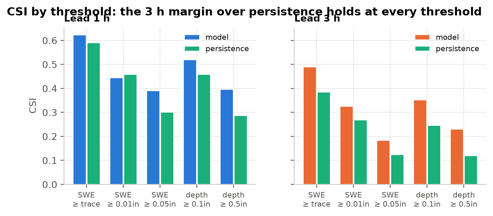
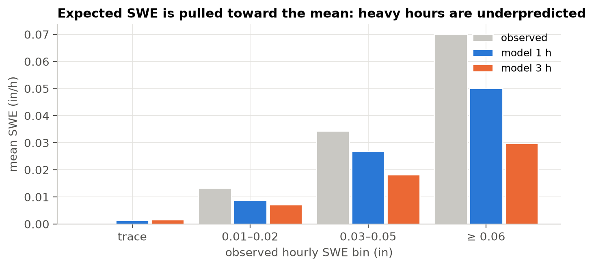
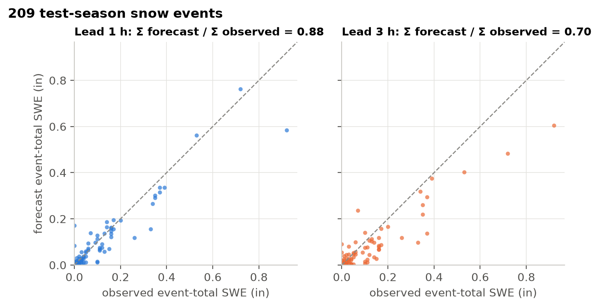
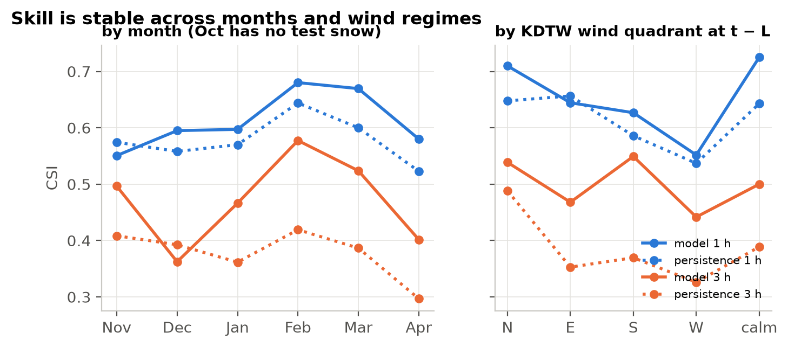
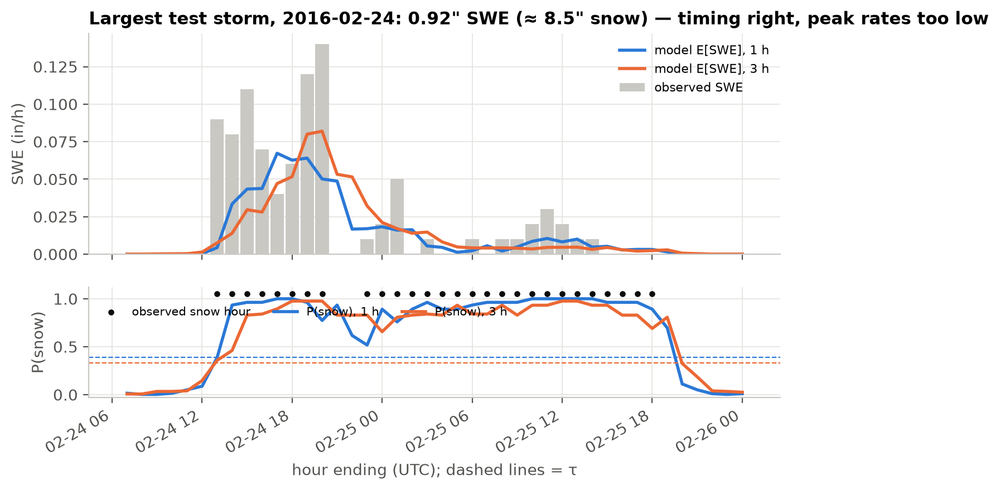
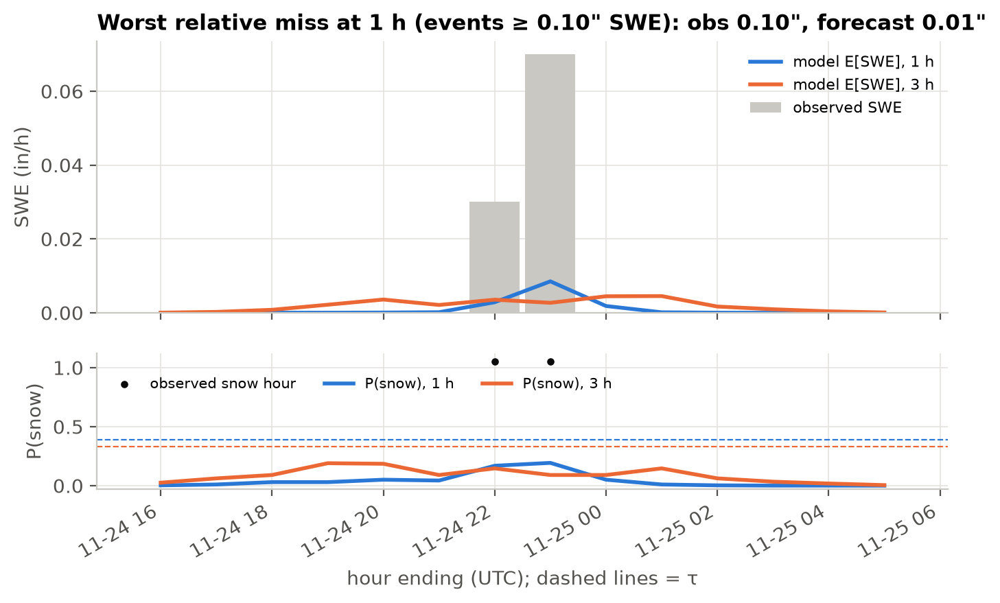
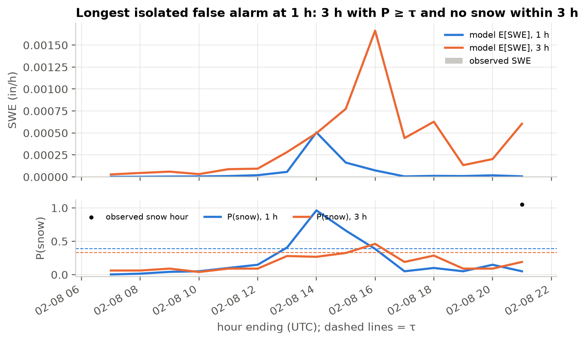

# 5. Held-out test results

**TL;DR.** On three winters the model never saw, it beats persistence and climatology on every
headline score at both leads, and its probabilities are well calibrated. The margin over
persistence is modest at 1 h and large at 3 h. Its weak spot is amount: heavy hours are
underpredicted, so storm totals come out low.

> [!IMPORTANT]
> **Protocol.** Test seasons 2015-16, 2020-21 and 2021-22 (15,271 hours, 1,280 of them snow
> hours) were scored **once**, on 2026-11-01 at commit `9e57483`. Models, calibrators, the Stage 2
> objective and τ were all frozen beforehand. A lock file
> ([`reports/TEST_EVALUATED.lock`](../reports/TEST_EVALUATED.lock)) makes the evaluation script
> refuse to run again. The figures on this page are redrawn from the stored predictions
> ([`reports/test_predictions_L*.parquet`](../reports/)); no model was re-run.

**Baselines.**
- **Persistence:** the observed KDTW value at *t − L*, the natural "no-skill nowcast".
- **Climatology:** the training-season snow rate and mean amount for each calendar month.

## Headline

| lead | system | Brier | BSS vs clim | ROC-AUC | PR-AUC | POD | FAR | CSI | RMSE SWE (in) |
|---|---|---|---|---|---|---|---|---|---|
| 1 h | **model** | **0.0281** | **0.613** | **0.982** | **0.834** | 0.757 | 0.220 | **0.624** | **0.0033** |
| 1 h | persistence | 0.0432 | 0.406 | 0.859 | 0.573 | 0.742 | 0.257 | 0.590 | 0.0043 |
| 3 h | **model** | **0.0392** | **0.460** | **0.963** | **0.705** | 0.676 | 0.359 | **0.490** | **0.0041** |
| 3 h | persistence | 0.0744 | −0.024 | 0.758 | 0.346 | 0.556 | 0.444 | 0.385 | 0.0062 |
| — | climatology | 0.0727 | 0 | 0.734 | 0.164 | 0 | — | 0 | 0.0053 |

*Figure 17. At 3 h, persistence has no Brier skill at all (−0.02), while the model keeps 0.46. Test
skill is a little below validation (BSS 0.666 / 0.503), as expected because τ and the calibrator
were fit on the validation winters.*

## Probabilities

*Figure 18. Calibrated probabilities (solid) sit close to the diagonal on unseen winters. The raw
1 h output (dotted) is over-confident. The histograms show sharpness: most hours are confidently
dry, and there is a second cluster of confident snow forecasts near 1.*

*Figure 19. Persistence is a single yes/no point (◆). The model's curves pass above it at both
leads. In the precision–recall view, which is the honest one for an event this rare, the 3 h gap
is wide.*

## Yes/no forecasts at higher thresholds

*Figure 20. Amount thresholds use the deterministic forecast. One exception to the pattern: at
0.01" SWE and 1 h, the model's CSI (0.445) is slightly below persistence (0.459). The model is
conservative on amounts (frequency bias 0.70), while persistence repeats the last hour exactly.*

## Amounts

*Figure 21. Expected SWE is pulled toward the mean. In heavy hours (≥ 0.06 in/h) the mean forecast
is 0.050 (1 h) and 0.030 (3 h) against 0.070 observed.*

*Figure 22. Across 209 snow events (snow-hour runs with gaps of up to 2 h), event totals correlate
well (r = 0.95 / 0.94) but come out 12% (1 h) and 30% (3 h) low. On this metric persistence does
better: shifting the observed series by L hours keeps almost all of each event's total.*

**Daily depth vs official snowfall** (634 test days, local standard time):

| system | Σ predicted / Σ GHCN | daily r |
|---|---|---|
| observed hourly target | 0.82 | 0.88 |
| model 1 h | 0.78 | 0.87 |
| model 3 h | 0.74 | 0.81 |

Most of the gap to the official record is in the target itself (gauge undercatch,
[page 2](02-target.md)), not model error.

## Stratified

*Figure 23. The model (solid) beats persistence (dotted) in most months and KDTW wind quadrants. The
wind quadrant is a rough proxy for synoptic vs lake-enhanced snow. The exceptions are close calls:
November and easterly winds at 1 h (CSI 0.55 vs 0.57 and 0.64 vs 0.66), and December at 3 h (0.36
vs 0.39). October has no test-season snow hours.*

## Case studies

Cases are chosen by rule, not by hand: the largest storm, the worst relative miss among events with at least
0.10" SWE, and the longest false-alarm run with no snow within 3 h.

*Figure 24. 2016-02-24/25: 30 hours, 0.92" SWE (about 8.5" of snow). Onset and end are timed well
at both leads. The peak rates are smeared out and underpredicted, the amount bias from Figure 21
in action.*

*Figure 25. The worst relative miss among events with at least 0.10" SWE: a two-hour burst on 2020-11-24, 0.10" observed against 0.01" forecast. P(snow) never crosses τ. Short, intense bursts like this give an hourly surface network little warning.*

*Figure 26. The longest false-alarm run in three winters with no snow nearby lasts only a few
hours, and the expected amount stays tiny. False alarms are mostly short timing errors at the
edges of real events.*

## Limitations and next steps

- **Heavy-rate bias.** Quantile or distributional Stage 2 objectives (for example α = 0.9) would
  give honest uncertainty bands for heavy hours.
- **Target undercatch.** A wind- and temperature-dependent gauge correction could bring the target
  closer to official snowfall.
- **Network gap.** No Ontario stations passed the precipitation-coverage filter, which leaves the
  east and north-east empty. Imputed or partial-coverage stations are an option.
- **Tuning budget.** Stage 1 ran 13–16 of 40 planned Optuna trials.
- **More inputs.** Radar, satellite and NWP fields would add information surface stations can't
  see, such as snow aloft and approaching bands.
- **Live mode.** All inputs are public in near-real time, so a `--live` predictor that pulls the
  last 14 h from IEM is a small step from here.

---
**Code:** [`src/evaluate.py`](../src/evaluate.py) · [`src/viz/figures.py`](../src/viz/figures.py)
**Generated reports:** [`reports/test_report.md`](../reports/test_report.md) (every table, by month, intensity and wind) · [`reports/test_metrics.json`](../reports/test_metrics.json)

[← Model](04-model.md) · [Next: reproducing →](06-reproduce.md)
