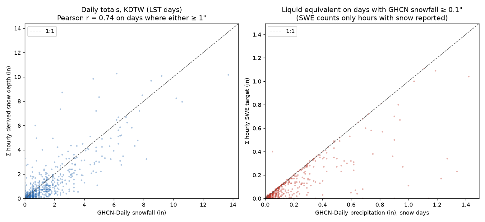

# Target validation: KDTW hourly snowfall vs GHCN-Daily

- Target hours: 106,968; available: 106,536 (99.60%)
- Snow-occurring hours (falling snow reported): 8.47% of available hours
- Snow-hour rate by split: test 8.38%, train 8.28%, val 9.47%
- Measurable-snow hours (SWE ≥ 0.01"): 2.25%; mixed-precip share of snow hours: 3.44%
- Days compared (LST, ≥ 20 available hours, GHCN SNOW present): 4,420
- Mean per-season ratio Σ derived depth / Σ GHCN snowfall: 0.79 (range 0.53–1.03)
- Mean per-season ratio Σ SWE / Σ GHCN precipitation on snow days: 0.65
- Daily Pearson r (days where either value ≥ 1"): 0.735
- Depth correction factor (Σ GHCN SNOW / Σ derived depth, train seasons only): 1.365 (informational; not applied to the training target)

## Per-season totals

| season | split | days | Σ derived depth (in) | Σ GHCN snow (in) | depth ratio | Σ SWE on snow days | Σ GHCN precip on snow days | SWE ratio |
|---|---|---|---|---|---|---|---|---|
| 2005-06 | train | 202 | 28.4 | 36.5 | 0.78 | 2.75 | 4.09 | 0.67 |
| 2006-07 | train | 211 | 16.0 | 30.3 | 0.53 | 0.82 | 2.40 | 0.34 |
| 2007-08 | train | 212 | 47.7 | 71.9 | 0.66 | 4.07 | 6.36 | 0.64 |
| 2008-09 | train | 208 | 44.4 | 64.9 | 0.68 | 3.51 | 5.47 | 0.64 |
| 2009-10 | train | 211 | 24.5 | 43.9 | 0.56 | 1.95 | 3.49 | 0.56 |
| 2010-11 | train | 208 | 38.9 | 65.3 | 0.60 | 3.09 | 5.99 | 0.52 |
| 2011-12 | train | 211 | 21.2 | 25.7 | 0.82 | 1.83 | 2.85 | 0.64 |
| 2012-13 | train | 211 | 34.1 | 48.0 | 0.71 | 3.05 | 4.52 | 0.68 |
| 2013-14 | train | 211 | 69.4 | 95.1 | 0.73 | 5.20 | 7.99 | 0.65 |
| 2014-15 | train | 211 | 30.3 | 47.5 | 0.64 | 2.11 | 2.79 | 0.76 |
| 2015-16 | test | 212 | 27.6 | 35.3 | 0.78 | 2.53 | 4.71 | 0.54 |
| 2016-17 | train | 211 | 31.4 | 38.2 | 0.82 | 2.65 | 4.09 | 0.65 |
| 2017-18 | val | 211 | 57.6 | 61.1 | 0.94 | 4.68 | 5.58 | 0.84 |
| 2018-19 | train | 211 | 32.3 | 31.5 | 1.03 | 2.73 | 5.20 | 0.52 |
| 2019-20 | val | 212 | 43.9 | 43.3 | 1.01 | 3.64 | 3.91 | 0.93 |
| 2020-21 | test | 211 | 40.4 | 45.1 | 0.90 | 3.38 | 4.22 | 0.80 |
| 2021-22 | test | 211 | 37.1 | 47.3 | 0.79 | 3.11 | 5.50 | 0.57 |
| 2022-23 | train | 211 | 36.8 | 37.3 | 0.99 | 3.45 | 4.94 | 0.70 |
| 2023-24 | train | 212 | 24.2 | 23.5 | 1.03 | 2.26 | 2.76 | 0.82 |
| 2024-25 | train | 211 | 24.7 | 28.8 | 0.86 | 1.85 | 2.98 | 0.62 |
| 2025-26 | val | 211 | 25.8 | 39.8 | 0.65 | 1.92 | 3.17 | 0.61 |

## Ten largest GHCN snowfall days

| date | GHCN snow (in) | snow hours | Σ SWE (in) | Σ derived depth (in) |
|---|---|---|---|---|
| 2015-02-01 | 13.7 | 22 | 0.70 | 10.2 |
| 2016-12-11 | 10.6 | 23 | 0.65 | 7.9 |
| 2014-01-05 | 10.2 | 21 | 0.70 | 8.2 |
| 2018-02-09 | 9.2 | 22 | 0.72 | 10.1 |
| 2019-11-11 | 8.5 | 23 | 0.81 | 9.7 |
| 2011-02-20 | 8.2 | 7 | 0.27 | 3.2 |
| 2008-12-19 | 7.9 | 10 | 0.68 | 8.5 |
| 2013-12-14 | 7.7 | 23 | 0.48 | 7.2 |
| 2014-02-05 | 7.6 | 14 | 0.32 | 4.8 |
| 2007-12-16 | 7.4 | 15 | 0.31 | 4.3 |
