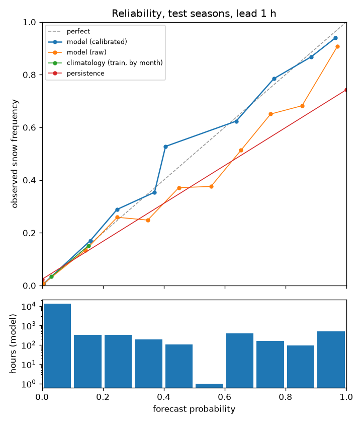
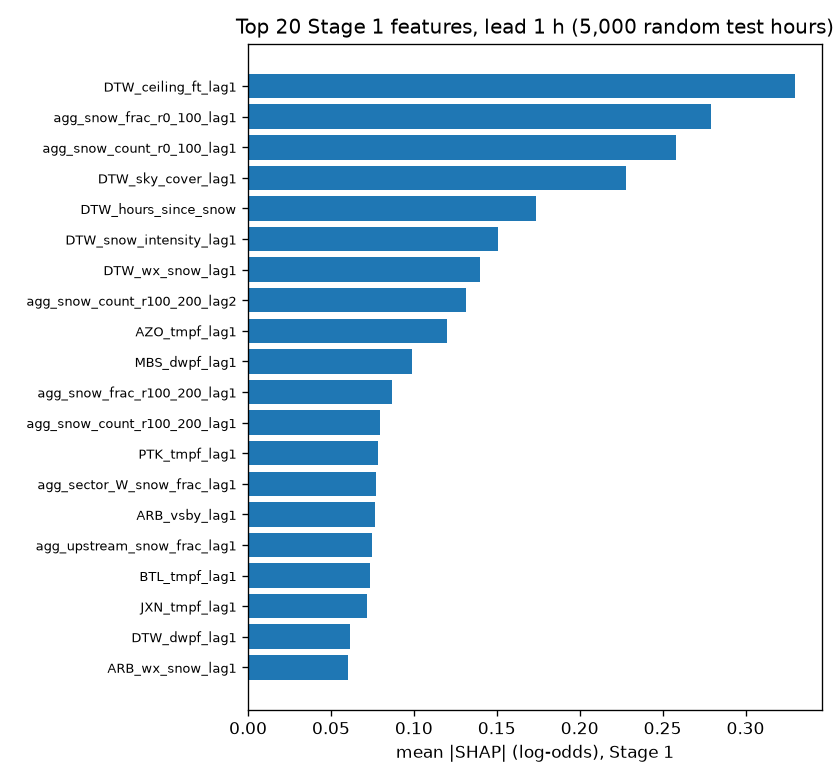
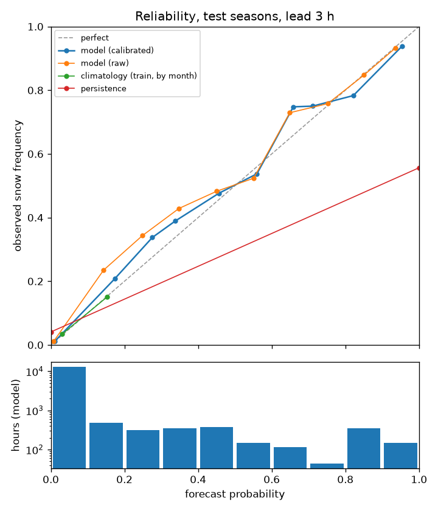
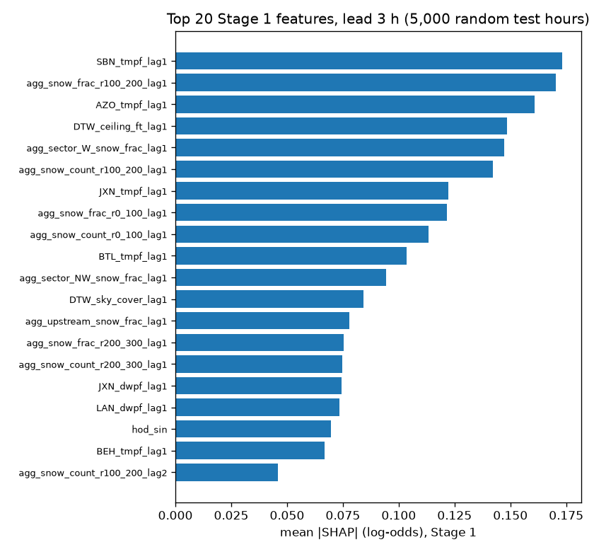
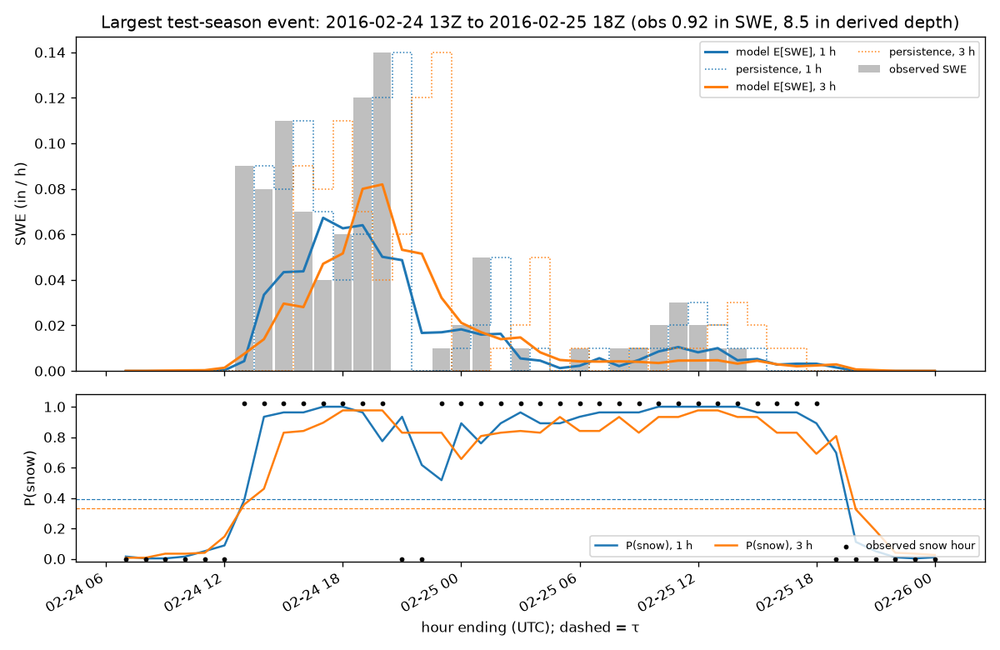

# Test-season evaluation (held out, scored once)

- Test seasons: 2015-16, 2020-21, 2021-22
- Evaluated: 2026-11-01T15:39:33+00:00 at git commit `9e57483`
- Models, isotonic calibrators, Stage 2 variants and τ are loaded unchanged from `models/lead_{1,3}h/`. Climatology = train-season snow rate / mean SWE / mean depth by calendar month. Persistence = the observed KDTW value at t − L.
- There are no pass/fail gates here; numbers are reported as they came out.

## Summary

| lead | system | brier | bss_clim | roc_auc | pr_auc | pod | far | csi | bias | mae | rmse | rmse_snow |
|---|---|---|---|---|---|---|---|---|---|---|---|---|
| 1 h | model | 0.0281 | 0.6129 | 0.9816 | 0.8341 | 0.7570 | 0.2204 | 0.6236 | 0.9711 | 0.0004 | 0.0033 | 0.0106 |
| 1 h | persistence | 0.0432 | 0.4063 | 0.8593 | 0.5729 | 0.7422 | 0.2572 | 0.5904 | 0.9992 | 0.0005 | 0.0043 | 0.0135 |
| 1 h | climatology | 0.0727 | 0.0000 | 0.7337 | 0.1638 | 0.0000 | nan | 0.0000 | 0.0000 | 0.0011 | 0.0053 | 0.0181 |
| 3 h | model | 0.0392 | 0.4600 | 0.9634 | 0.7052 | 0.6758 | 0.3588 | 0.4904 | 1.0539 | 0.0007 | 0.0041 | 0.0129 |
| 3 h | persistence | 0.0744 | -0.0235 | 0.7575 | 0.3463 | 0.5555 | 0.4437 | 0.3849 | 0.9984 | 0.0008 | 0.0062 | 0.0186 |
| 3 h | climatology | 0.0727 | 0.0000 | 0.7337 | 0.1638 | 0.0000 | nan | 0.0000 | 0.0000 | 0.0011 | 0.0053 | 0.0181 |

Validation-season numbers for comparison (calibration and τ were fit on those seasons): see `reports/val_metrics.md`.

## Lead 1 h

- Test rows: 15,271 hours (1,280 snow hours, rate 0.0838). Stage 2 variant `tweedie`, τ = 0.39 (both fixed in Phase 6).
- Skill vs. persistence: MAE skill +0.155, CSI 0.624 vs 0.590 (+0.033).

### Headline (hourly, all test hours)

`mae`/`rmse` use the expected SWE; `_snow` restricts to observed snow hours; `_det` uses the deterministic SWE (amount if P ≥ τ, else 0). Persistence probability is 0/1. Categorical scores use P ≥ τ (model) or ≥ 0.5 (persistence, climatology).

| system | brier | bss_clim | roc_auc | pr_auc | pod | far | csi | bias | mae | rmse | mae_snow | rmse_snow | mae_det | rmse_det |
|---|---|---|---|---|---|---|---|---|---|---|---|---|---|---|
| model | 0.0281 | 0.6129 | 0.9816 | 0.8341 | 0.7570 | 0.2204 | 0.6236 | 0.9711 | 0.0004 | 0.0033 | 0.0043 | 0.0106 | 0.0004 | 0.0035 |
| persistence | 0.0432 | 0.4063 | 0.8593 | 0.5729 | 0.7422 | 0.2572 | 0.5904 | 0.9992 | 0.0005 | 0.0043 | 0.0054 | 0.0135 | 0.0005 | 0.0043 |
| climatology | 0.0727 | 0.0000 | 0.7337 | 0.1638 | 0.0000 | nan | 0.0000 | 0.0000 | 0.0011 | 0.0053 | 0.0076 | 0.0181 | 0.0011 | 0.0053 |

### Occurrence by threshold

Trace uses the occurrence forecast; amount thresholds use the deterministic SWE (or depth = deterministic SWE × SLR(T at t−L)). Observed depth is the derived hourly target.

| quantity | threshold | system | n_obs | pod | far | csi | bias |
|---|---|---|---|---|---|---|---|
| SWE | trace | model | 1,280 | 0.7570 | 0.2204 | 0.6236 | 0.9711 |
| SWE | trace | persistence | 1,280 | 0.7422 | 0.2572 | 0.5904 | 0.9992 |
| SWE | trace | climatology | 1,280 | 0.0000 | nan | 0.0000 | 0.0000 |
| SWE | 0.01in | model | 361 | 0.5235 | 0.2530 | 0.4447 | 0.7008 |
| SWE | 0.01in | persistence | 361 | 0.6288 | 0.3712 | 0.4586 | 1.0000 |
| SWE | 0.01in | climatology | 361 | 0.0000 | nan | 0.0000 | 0.0000 |
| SWE | 0.05in | model | 54 | 0.5000 | 0.3571 | 0.3913 | 0.7778 |
| SWE | 0.05in | persistence | 54 | 0.4630 | 0.5370 | 0.3012 | 1.0000 |
| SWE | 0.05in | climatology | 54 | 0.0000 | nan | 0.0000 | 0.0000 |
| depth | 0.1in | model | 308 | 0.6526 | 0.2796 | 0.5207 | 0.9058 |
| depth | 0.1in | persistence | 308 | 0.6299 | 0.3701 | 0.4597 | 1.0000 |
| depth | 0.1in | climatology | 308 | 0.0000 | nan | 0.0000 | 0.0000 |
| depth | 0.5in | model | 56 | 0.5536 | 0.4151 | 0.3974 | 0.9464 |
| depth | 0.5in | persistence | 56 | 0.4464 | 0.5536 | 0.2874 | 1.0000 |
| depth | 0.5in | climatology | 56 | 0.0000 | nan | 0.0000 | 0.0000 |

### Event totals (209 events; snow-hour runs with gaps ≤ 2 h)

Error of the event-total SWE / derived depth (forecast − observed), summed from the expected values.

| quantity | system | n_events | mae | bias | ratio_total | r |
|---|---|---|---|---|---|---|
| swe | model | 209 | 0.0132 | -0.0054 | 0.8773 | 0.9523 |
| depth | model | 209 | 0.1452 | -0.0680 | 0.8647 | 0.9559 |
| swe | persistence | 209 | 0.0026 | -0.0026 | 0.9413 | 0.9951 |
| depth | persistence | 209 | 0.0247 | -0.0247 | 0.9508 | 0.9963 |
| swe | climatology | 209 | 0.0423 | -0.0379 | 0.1400 | 0.5335 |
| depth | climatology | 209 | 0.4840 | -0.4293 | 0.1465 | 0.5601 |

### Daily depth vs. GHCN `SNOW`

LST days with ≥ 20 test hours. `r_big` uses days where either value is ≥ 1". The observed hourly target row shows how much of the gap to GHCN is gauge undercatch rather than model error (train-season depth correction factor 1.365, not applied).

| system | n_days | sum_pred | sum_ghcn | ratio | mae | r_all | r_big | n_big |
|---|---|---|---|---|---|---|---|---|
| observed hourly target | 634 | 105.120 | 127.677 | 0.823 | 0.087 | 0.882 | 0.707 | 45 |
| model | 634 | 98.919 | 127.677 | 0.775 | 0.102 | 0.869 | 0.665 | 48 |
| persistence | 634 | 105.120 | 127.677 | 0.823 | 0.089 | 0.877 | 0.694 | 46 |
| climatology | 634 | 101.369 | 127.677 | 0.794 | 0.286 | 0.203 | 0.113 | 41 |

### By month

| group | system | n | snow_rate | brier | bss_clim | pod | far | csi | mae | rmse |
|---|---|---|---|---|---|---|---|---|---|---|
| Oct | model | 2,224 | 0.0000 | 0.0000 | -19.6849 | nan | nan | nan | 0.0000 | 0.0000 |
| Oct | persistence | 2,224 | 0.0000 | 0.0000 | 1.0000 | nan | nan | nan | 0.0000 | 0.0000 |
| Oct | climatology | 2,224 | 0.0000 | 0.0000 | 0.0000 | nan | nan | nan | 0.0000 | 0.0000 |
| Nov | model | 2,159 | 0.0542 | 0.0198 | 0.6138 | 0.6496 | 0.2165 | 0.5507 | 0.0005 | 0.0042 |
| Nov | persistence | 2,159 | 0.0542 | 0.0292 | 0.4313 | 0.7265 | 0.2672 | 0.5743 | 0.0006 | 0.0049 |
| Nov | climatology | 2,159 | 0.0542 | 0.0513 | 0.0000 | 0.0000 | nan | 0.0000 | 0.0011 | 0.0068 |
| Dec | model | 2,229 | 0.0749 | 0.0273 | 0.6180 | 0.7126 | 0.2171 | 0.5950 | 0.0004 | 0.0026 |
| Dec | persistence | 2,229 | 0.0749 | 0.0426 | 0.4033 | 0.7186 | 0.2857 | 0.5581 | 0.0006 | 0.0045 |
| Dec | climatology | 2,229 | 0.0749 | 0.0714 | 0.0000 | 0.0000 | nan | 0.0000 | 0.0012 | 0.0043 |
| Jan | model | 2,231 | 0.1833 | 0.0679 | 0.5464 | 0.7359 | 0.2399 | 0.5972 | 0.0006 | 0.0033 |
| Jan | persistence | 2,231 | 0.1833 | 0.1004 | 0.3294 | 0.7262 | 0.2738 | 0.5701 | 0.0007 | 0.0043 |
| Jan | climatology | 2,231 | 0.1833 | 0.1497 | 0.0000 | 0.0000 | nan | 0.0000 | 0.0016 | 0.0046 |
| Feb | model | 2,039 | 0.1962 | 0.0543 | 0.6601 | 0.8400 | 0.2186 | 0.6802 | 0.0011 | 0.0057 |
| Feb | persistence | 2,039 | 0.1962 | 0.0848 | 0.4684 | 0.7825 | 0.2155 | 0.6440 | 0.0015 | 0.0080 |
| Feb | climatology | 2,039 | 0.1962 | 0.1596 | 0.0000 | 0.0000 | nan | 0.0000 | 0.0029 | 0.0100 |
| Mar | model | 2,230 | 0.0466 | 0.0138 | 0.6903 | 0.7596 | 0.1505 | 0.6695 | 0.0002 | 0.0021 |
| Mar | persistence | 2,230 | 0.0466 | 0.0233 | 0.4780 | 0.7500 | 0.2500 | 0.6000 | 0.0002 | 0.0023 |
| Mar | climatology | 2,230 | 0.0466 | 0.0447 | 0.0000 | 0.0000 | nan | 0.0000 | 0.0008 | 0.0031 |
| Apr | model | 2,159 | 0.0384 | 0.0153 | 0.5920 | 0.6988 | 0.2267 | 0.5800 | 0.0003 | 0.0023 |
| Apr | persistence | 2,159 | 0.0384 | 0.0241 | 0.3570 | 0.6867 | 0.3133 | 0.5229 | 0.0002 | 0.0018 |
| Apr | climatology | 2,159 | 0.0384 | 0.0375 | 0.0000 | 0.0000 | nan | 0.0000 | 0.0004 | 0.0025 |

### By observed intensity (snow hours only)

`pod` = share of the bin's hours forecast as snow; `mean_p` = mean forecast probability.

| bin | system | n | mean_obs | mean_pred | mean_p | pod | mae | bias |
|---|---|---|---|---|---|---|---|---|
| trace | model | 919 | 0.0000 | 0.0014 | 0.5847 | 0.6823 | 0.0014 | 0.0014 |
| trace | persistence | 919 | 0.0000 | 0.0015 | 0.6725 | 0.6725 | 0.0015 | 0.0015 |
| trace | climatology | 919 | 0.0000 | 0.0009 | 0.1380 | 0.0000 | 0.0009 | 0.0009 |
| 0.01-0.02 | model | 244 | 0.0133 | 0.0087 | 0.8702 | 0.9549 | 0.0074 | -0.0045 |
| 0.01-0.02 | persistence | 244 | 0.0133 | 0.0107 | 0.9262 | 0.9262 | 0.0101 | -0.0025 |
| 0.01-0.02 | climatology | 244 | 0.0133 | 0.0009 | 0.1205 | 0.0000 | 0.0124 | -0.0124 |
| 0.03-0.05 | model | 63 | 0.0344 | 0.0269 | 0.8947 | 0.9365 | 0.0133 | -0.0075 |
| 0.03-0.05 | persistence | 63 | 0.0344 | 0.0283 | 0.9048 | 0.9048 | 0.0198 | -0.0062 |
| 0.03-0.05 | climatology | 63 | 0.0344 | 0.0007 | 0.1077 | 0.0000 | 0.0337 | -0.0337 |
| >=0.06 | model | 54 | 0.0702 | 0.0500 | 0.9039 | 0.9259 | 0.0305 | -0.0202 |
| >=0.06 | persistence | 54 | 0.0702 | 0.0461 | 0.9074 | 0.9074 | 0.0341 | -0.0241 |
| >=0.06 | climatology | 54 | 0.0702 | 0.0009 | 0.1218 | 0.0000 | 0.0693 | -0.0693 |

### By KDTW wind quadrant at t − L (synoptic vs. lake-enhanced proxy)

| group | system | n | snow_rate | brier | bss_clim | pod | far | csi | mae | rmse |
|---|---|---|---|---|---|---|---|---|---|---|
| N | model | 2,672 | 0.1568 | 0.0421 | 0.6727 | 0.8115 | 0.1500 | 0.7098 | 0.0011 | 0.0054 |
| N | persistence | 2,672 | 0.1568 | 0.0674 | 0.4768 | 0.7900 | 0.2175 | 0.6477 | 0.0012 | 0.0064 |
| N | climatology | 2,672 | 0.1568 | 0.1288 | 0.0000 | 0.0000 | nan | 0.0000 | 0.0022 | 0.0091 |
| E | model | 1,922 | 0.0552 | 0.0173 | 0.6542 | 0.8208 | 0.2500 | 0.6444 | 0.0008 | 0.0048 |
| E | persistence | 1,922 | 0.0552 | 0.0234 | 0.5322 | 0.8113 | 0.2252 | 0.6565 | 0.0008 | 0.0060 |
| E | climatology | 1,922 | 0.0552 | 0.0500 | 0.0000 | 0.0000 | nan | 0.0000 | 0.0012 | 0.0062 |
| S | model | 4,575 | 0.0415 | 0.0127 | 0.6960 | 0.7158 | 0.1656 | 0.6267 | 0.0002 | 0.0023 |
| S | persistence | 4,575 | 0.0415 | 0.0205 | 0.5085 | 0.7000 | 0.2176 | 0.5859 | 0.0003 | 0.0041 |
| S | climatology | 4,575 | 0.0415 | 0.0418 | 0.0000 | 0.0000 | nan | 0.0000 | 0.0009 | 0.0046 |
| W | model | 4,790 | 0.1100 | 0.0446 | 0.5129 | 0.7078 | 0.2854 | 0.5518 | 0.0002 | 0.0015 |
| W | persistence | 4,790 | 0.1100 | 0.0666 | 0.2723 | 0.7021 | 0.3045 | 0.5370 | 0.0002 | 0.0020 |
| W | climatology | 4,790 | 0.1100 | 0.0915 | 0.0000 | 0.0000 | nan | 0.0000 | 0.0008 | 0.0022 |
| calm | model | 1,173 | 0.0273 | 0.0080 | 0.7345 | 0.9062 | 0.2162 | 0.7250 | 0.0002 | 0.0016 |
| calm | persistence | 1,173 | 0.0273 | 0.0128 | 0.5742 | 0.8438 | 0.2703 | 0.6429 | 0.0002 | 0.0025 |
| calm | climatology | 1,173 | 0.0273 | 0.0300 | 0.0000 | 0.0000 | nan | 0.0000 | 0.0007 | 0.0027 |
| missing | model | 139 | 0.0432 | 0.0196 | 0.4345 | 0.6667 | 0.2000 | 0.5714 | 0.0001 | 0.0014 |
| missing | persistence | 139 | 0.0432 | 0.0432 | -0.2436 | 0.5000 | 0.5000 | 0.3333 | 0.0006 | 0.0062 |
| missing | climatology | 139 | 0.0432 | 0.0347 | 0.0000 | 0.0000 | nan | 0.0000 | 0.0005 | 0.0017 |

### Top 20 Stage 1 features (mean |SHAP|, log-odds)

`DTW_ceiling_ft_lag1` 0.330, `agg_snow_frac_r0_100_lag1` 0.279, `agg_snow_count_r0_100_lag1` 0.258, `DTW_sky_cover_lag1` 0.228, `DTW_hours_since_snow` 0.174, `DTW_snow_intensity_lag1` 0.151, `DTW_wx_snow_lag1` 0.140, `agg_snow_count_r100_200_lag2` 0.131, `AZO_tmpf_lag1` 0.120, `MBS_dwpf_lag1` 0.099, `agg_snow_frac_r100_200_lag1` 0.087, `agg_snow_count_r100_200_lag1` 0.079, `PTK_tmpf_lag1` 0.078, `agg_sector_W_snow_frac_lag1` 0.077, `ARB_vsby_lag1` 0.076, `agg_upstream_snow_frac_lag1` 0.075, `BTL_tmpf_lag1` 0.073, `JXN_tmpf_lag1` 0.072, `DTW_dwpf_lag1` 0.062, `ARB_wx_snow_lag1` 0.060

## Lead 3 h

- Test rows: 15,271 hours (1,280 snow hours, rate 0.0838). Stage 2 variant `tweedie`, τ = 0.33 (both fixed in Phase 6).
- Skill vs. persistence: MAE skill +0.218, CSI 0.490 vs 0.385 (+0.105).

### Headline (hourly, all test hours)

`mae`/`rmse` use the expected SWE; `_snow` restricts to observed snow hours; `_det` uses the deterministic SWE (amount if P ≥ τ, else 0). Persistence probability is 0/1. Categorical scores use P ≥ τ (model) or ≥ 0.5 (persistence, climatology).

| system | brier | bss_clim | roc_auc | pr_auc | pod | far | csi | bias | mae | rmse | mae_snow | rmse_snow | mae_det | rmse_det |
|---|---|---|---|---|---|---|---|---|---|---|---|---|---|---|
| model | 0.0392 | 0.4600 | 0.9634 | 0.7052 | 0.6758 | 0.3588 | 0.4904 | 1.0539 | 0.0007 | 0.0041 | 0.0057 | 0.0129 | 0.0007 | 0.0044 |
| persistence | 0.0744 | -0.0235 | 0.7575 | 0.3463 | 0.5555 | 0.4437 | 0.3849 | 0.9984 | 0.0008 | 0.0062 | 0.0079 | 0.0186 | 0.0008 | 0.0062 |
| climatology | 0.0727 | 0.0000 | 0.7337 | 0.1638 | 0.0000 | nan | 0.0000 | 0.0000 | 0.0011 | 0.0053 | 0.0076 | 0.0181 | 0.0011 | 0.0053 |

### Occurrence by threshold

Trace uses the occurrence forecast; amount thresholds use the deterministic SWE (or depth = deterministic SWE × SLR(T at t−L)). Observed depth is the derived hourly target.

| quantity | threshold | system | n_obs | pod | far | csi | bias |
|---|---|---|---|---|---|---|---|
| SWE | trace | model | 1,280 | 0.6758 | 0.3588 | 0.4904 | 1.0539 |
| SWE | trace | persistence | 1,280 | 0.5555 | 0.4437 | 0.3849 | 0.9984 |
| SWE | trace | climatology | 1,280 | 0.0000 | nan | 0.0000 | 0.0000 |
| SWE | 0.01in | model | 361 | 0.4211 | 0.4086 | 0.3262 | 0.7119 |
| SWE | 0.01in | persistence | 361 | 0.4238 | 0.5762 | 0.2689 | 1.0000 |
| SWE | 0.01in | climatology | 361 | 0.0000 | nan | 0.0000 | 0.0000 |
| SWE | 0.05in | model | 54 | 0.2593 | 0.6111 | 0.1842 | 0.6667 |
| SWE | 0.05in | persistence | 54 | 0.2222 | 0.7778 | 0.1250 | 1.0000 |
| SWE | 0.05in | climatology | 54 | 0.0000 | nan | 0.0000 | 0.0000 |
| depth | 0.1in | model | 308 | 0.5162 | 0.4735 | 0.3525 | 0.9805 |
| depth | 0.1in | persistence | 308 | 0.3961 | 0.6039 | 0.2470 | 1.0000 |
| depth | 0.1in | climatology | 308 | 0.0000 | nan | 0.0000 | 0.0000 |
| depth | 0.5in | model | 56 | 0.3214 | 0.5500 | 0.2308 | 0.7143 |
| depth | 0.5in | persistence | 56 | 0.2143 | 0.7857 | 0.1200 | 1.0000 |
| depth | 0.5in | climatology | 56 | 0.0000 | nan | 0.0000 | 0.0000 |

### Event totals (209 events; snow-hour runs with gaps ≤ 2 h)

Error of the event-total SWE / derived depth (forecast − observed), summed from the expected values.

| quantity | system | n_events | mae | bias | ratio_total | r |
|---|---|---|---|---|---|---|
| swe | model | 209 | 0.0200 | -0.0131 | 0.7022 | 0.9388 |
| depth | model | 209 | 0.2327 | -0.1577 | 0.6865 | 0.9312 |
| swe | persistence | 209 | 0.0076 | -0.0076 | 0.8283 | 0.9802 |
| depth | persistence | 209 | 0.0817 | -0.0817 | 0.8376 | 0.9823 |
| swe | climatology | 209 | 0.0423 | -0.0379 | 0.1400 | 0.5335 |
| depth | climatology | 209 | 0.4840 | -0.4293 | 0.1465 | 0.5601 |

### Daily depth vs. GHCN `SNOW`

LST days with ≥ 20 test hours. `r_big` uses days where either value is ≥ 1". The observed hourly target row shows how much of the gap to GHCN is gauge undercatch rather than model error (train-season depth correction factor 1.365, not applied).

| system | n_days | sum_pred | sum_ghcn | ratio | mae | r_all | r_big | n_big |
|---|---|---|---|---|---|---|---|---|
| observed hourly target | 634 | 105.120 | 127.677 | 0.823 | 0.087 | 0.882 | 0.707 | 45 |
| model | 634 | 94.716 | 127.677 | 0.742 | 0.133 | 0.811 | 0.537 | 50 |
| persistence | 634 | 105.120 | 127.677 | 0.823 | 0.105 | 0.847 | 0.627 | 49 |
| climatology | 634 | 101.369 | 127.677 | 0.794 | 0.286 | 0.203 | 0.113 | 41 |

### By month

| group | system | n | snow_rate | brier | bss_clim | pod | far | csi | mae | rmse |
|---|---|---|---|---|---|---|---|---|---|---|
| Oct | model | 2,224 | 0.0000 | 0.0000 | -44.5315 | nan | nan | nan | 0.0000 | 0.0000 |
| Oct | persistence | 2,224 | 0.0000 | 0.0000 | 1.0000 | nan | nan | nan | 0.0000 | 0.0000 |
| Oct | climatology | 2,224 | 0.0000 | 0.0000 | 0.0000 | nan | nan | nan | 0.0000 | 0.0000 |
| Nov | model | 2,159 | 0.0542 | 0.0258 | 0.4973 | 0.6068 | 0.2680 | 0.4965 | 0.0007 | 0.0050 |
| Nov | persistence | 2,159 | 0.0542 | 0.0449 | 0.1243 | 0.5726 | 0.4123 | 0.4085 | 0.0011 | 0.0075 |
| Nov | climatology | 2,159 | 0.0542 | 0.0513 | 0.0000 | 0.0000 | nan | 0.0000 | 0.0011 | 0.0068 |
| Dec | model | 2,229 | 0.0749 | 0.0430 | 0.3979 | 0.4970 | 0.4276 | 0.3624 | 0.0008 | 0.0046 |
| Dec | persistence | 2,229 | 0.0749 | 0.0659 | 0.0767 | 0.5689 | 0.4412 | 0.3926 | 0.0008 | 0.0058 |
| Dec | climatology | 2,229 | 0.0749 | 0.0714 | 0.0000 | 0.0000 | nan | 0.0000 | 0.0012 | 0.0043 |
| Jan | model | 2,231 | 0.1833 | 0.0912 | 0.3910 | 0.6601 | 0.3864 | 0.4663 | 0.0008 | 0.0040 |
| Jan | persistence | 2,231 | 0.1833 | 0.1717 | -0.1466 | 0.5306 | 0.4681 | 0.3617 | 0.0010 | 0.0059 |
| Jan | climatology | 2,231 | 0.1833 | 0.1497 | 0.0000 | 0.0000 | nan | 0.0000 | 0.0016 | 0.0046 |
| Feb | model | 2,039 | 0.1962 | 0.0748 | 0.5314 | 0.7925 | 0.3197 | 0.5774 | 0.0015 | 0.0068 |
| Feb | persistence | 2,039 | 0.1962 | 0.1604 | -0.0048 | 0.5900 | 0.4085 | 0.4192 | 0.0024 | 0.0115 |
| Feb | climatology | 2,039 | 0.1962 | 0.1596 | 0.0000 | 0.0000 | nan | 0.0000 | 0.0029 | 0.0100 |
| Mar | model | 2,230 | 0.0466 | 0.0210 | 0.5306 | 0.7404 | 0.3583 | 0.5238 | 0.0004 | 0.0027 |
| Mar | persistence | 2,230 | 0.0466 | 0.0413 | 0.0764 | 0.5577 | 0.4423 | 0.3867 | 0.0004 | 0.0038 |
| Mar | climatology | 2,230 | 0.0466 | 0.0447 | 0.0000 | 0.0000 | nan | 0.0000 | 0.0008 | 0.0031 |
| Apr | model | 2,159 | 0.0384 | 0.0209 | 0.4418 | 0.5663 | 0.4198 | 0.4017 | 0.0004 | 0.0022 |
| Apr | persistence | 2,159 | 0.0384 | 0.0417 | -0.1128 | 0.4578 | 0.5422 | 0.2969 | 0.0002 | 0.0020 |
| Apr | climatology | 2,159 | 0.0384 | 0.0375 | 0.0000 | 0.0000 | nan | 0.0000 | 0.0004 | 0.0025 |

### By observed intensity (snow hours only)

`pod` = share of the bin's hours forecast as snow; `mean_p` = mean forecast probability.

| bin | system | n | mean_obs | mean_pred | mean_p | pod | mae | bias |
|---|---|---|---|---|---|---|---|---|
| trace | model | 919 | 0.0000 | 0.0016 | 0.4567 | 0.6104 | 0.0016 | 0.0016 |
| trace | persistence | 919 | 0.0000 | 0.0020 | 0.5158 | 0.5158 | 0.0020 | 0.0020 |
| trace | climatology | 919 | 0.0000 | 0.0009 | 0.1380 | 0.0000 | 0.0009 | 0.0009 |
| 0.01-0.02 | model | 244 | 0.0133 | 0.0071 | 0.6788 | 0.8320 | 0.0093 | -0.0061 |
| 0.01-0.02 | persistence | 244 | 0.0133 | 0.0105 | 0.7049 | 0.7049 | 0.0139 | -0.0028 |
| 0.01-0.02 | climatology | 244 | 0.0133 | 0.0009 | 0.1205 | 0.0000 | 0.0124 | -0.0124 |
| 0.03-0.05 | model | 63 | 0.0344 | 0.0182 | 0.7266 | 0.8413 | 0.0199 | -0.0163 |
| 0.03-0.05 | persistence | 63 | 0.0344 | 0.0183 | 0.6667 | 0.6667 | 0.0273 | -0.0162 |
| 0.03-0.05 | climatology | 63 | 0.0344 | 0.0007 | 0.1077 | 0.0000 | 0.0337 | -0.0337 |
| >=0.06 | model | 54 | 0.0702 | 0.0297 | 0.7072 | 0.8889 | 0.0416 | -0.0405 |
| >=0.06 | persistence | 54 | 0.0702 | 0.0196 | 0.4259 | 0.4259 | 0.0583 | -0.0506 |
| >=0.06 | climatology | 54 | 0.0702 | 0.0009 | 0.1218 | 0.0000 | 0.0693 | -0.0693 |

### By KDTW wind quadrant at t − L (synoptic vs. lake-enhanced proxy)

| group | system | n | snow_rate | brier | bss_clim | pod | far | csi | mae | rmse |
|---|---|---|---|---|---|---|---|---|---|---|
| N | model | 2,671 | 0.1486 | 0.0590 | 0.5165 | 0.6826 | 0.2812 | 0.5388 | 0.0013 | 0.0058 |
| N | persistence | 2,671 | 0.1486 | 0.1056 | 0.1350 | 0.6776 | 0.3641 | 0.4882 | 0.0019 | 0.0094 |
| N | climatology | 2,671 | 0.1486 | 0.1221 | 0.0000 | 0.0000 | nan | 0.0000 | 0.0021 | 0.0087 |
| E | model | 1,918 | 0.0626 | 0.0323 | 0.4212 | 0.7333 | 0.4359 | 0.4681 | 0.0015 | 0.0070 |
| E | persistence | 1,918 | 0.0626 | 0.0574 | -0.0283 | 0.5000 | 0.4545 | 0.3529 | 0.0014 | 0.0084 |
| E | climatology | 1,918 | 0.0626 | 0.0558 | 0.0000 | 0.0000 | nan | 0.0000 | 0.0014 | 0.0070 |
| S | model | 4,574 | 0.0455 | 0.0189 | 0.5779 | 0.6971 | 0.2786 | 0.5492 | 0.0004 | 0.0034 |
| S | persistence | 4,574 | 0.0455 | 0.0380 | 0.1516 | 0.4904 | 0.4000 | 0.3696 | 0.0006 | 0.0056 |
| S | climatology | 4,574 | 0.0455 | 0.0448 | 0.0000 | 0.0000 | nan | 0.0000 | 0.0009 | 0.0045 |
| W | model | 4,790 | 0.1071 | 0.0566 | 0.3666 | 0.6433 | 0.4149 | 0.4418 | 0.0003 | 0.0019 |
| W | persistence | 4,790 | 0.1071 | 0.1109 | -0.2403 | 0.5010 | 0.5169 | 0.3261 | 0.0004 | 0.0028 |
| W | climatology | 4,790 | 0.1071 | 0.0894 | 0.0000 | 0.0000 | nan | 0.0000 | 0.0008 | 0.0024 |
| calm | model | 1,173 | 0.0324 | 0.0174 | 0.4927 | 0.7368 | 0.3913 | 0.5000 | 0.0003 | 0.0022 |
| calm | persistence | 1,173 | 0.0324 | 0.0281 | 0.1779 | 0.5526 | 0.4324 | 0.3889 | 0.0004 | 0.0044 |
| calm | climatology | 1,173 | 0.0324 | 0.0342 | 0.0000 | 0.0000 | nan | 0.0000 | 0.0007 | 0.0027 |
| missing | model | 145 | 0.0276 | 0.0122 | 0.5067 | 0.7500 | 0.4000 | 0.5000 | 0.0004 | 0.0031 |
| missing | persistence | 145 | 0.0276 | 0.0414 | -0.6785 | 0.5000 | 0.6667 | 0.2500 | 0.0008 | 0.0067 |
| missing | climatology | 145 | 0.0276 | 0.0247 | 0.0000 | 0.0000 | nan | 0.0000 | 0.0007 | 0.0033 |

### Top 20 Stage 1 features (mean |SHAP|, log-odds)

`SBN_tmpf_lag1` 0.173, `agg_snow_frac_r100_200_lag1` 0.170, `AZO_tmpf_lag1` 0.161, `DTW_ceiling_ft_lag1` 0.149, `agg_sector_W_snow_frac_lag1` 0.147, `agg_snow_count_r100_200_lag1` 0.142, `JXN_tmpf_lag1` 0.122, `agg_snow_frac_r0_100_lag1` 0.122, `agg_snow_count_r0_100_lag1` 0.113, `BTL_tmpf_lag1` 0.104, `agg_sector_NW_snow_frac_lag1` 0.094, `DTW_sky_cover_lag1` 0.084, `agg_upstream_snow_frac_lag1` 0.078, `agg_snow_frac_r200_300_lag1` 0.075, `agg_snow_count_r200_300_lag1` 0.075, `JXN_dwpf_lag1` 0.074, `LAN_dwpf_lag1` 0.073, `hod_sin` 0.070, `BEH_tmpf_lag1` 0.067, `agg_snow_count_r100_200_lag2` 0.046

## Largest test-season storm

2016-02-24 13Z – 2016-02-25 18Z, 30 h, observed 0.92" SWE (8.5" derived depth).

